[← Volver al laboratorio](../README.md)

# 00 · Instalación de Red Hat Enterprise Linux 8/9

Instalación de **Red Hat Enterprise Linux 8.9** en una máquina virtual con VMware Workstation Pro 17. Esta es la base sobre la que se realizan el resto de las prácticas del laboratorio de Linux/RHEL.

## Entorno

| Elemento | Valor |
|---|---|
| Hipervisor | VMware Workstation Pro 17 |
| Sistema operativo | Red Hat Enterprise Linux 8.9 |
| Imagen | `rhel-8.9-x86_64-dvd.iso` |

## Índice

- [Parte A: Crear la máquina virtual](#parte-a-crear-la-máquina-virtual)
- [Parte B: Arrancar e instalar RHEL](#parte-b-arrancar-e-instalar-rhel)
- [Parte C: Primer inicio del sistema](#parte-c-primer-inicio-del-sistema)
- [Solución de problemas frecuentes](#solución-de-problemas-frecuentes)

---

## Parte A: Crear la máquina virtual

**1.** Abrimos VMware Workstation Pro 17 y creamos una nueva máquina virtual con el asistente.

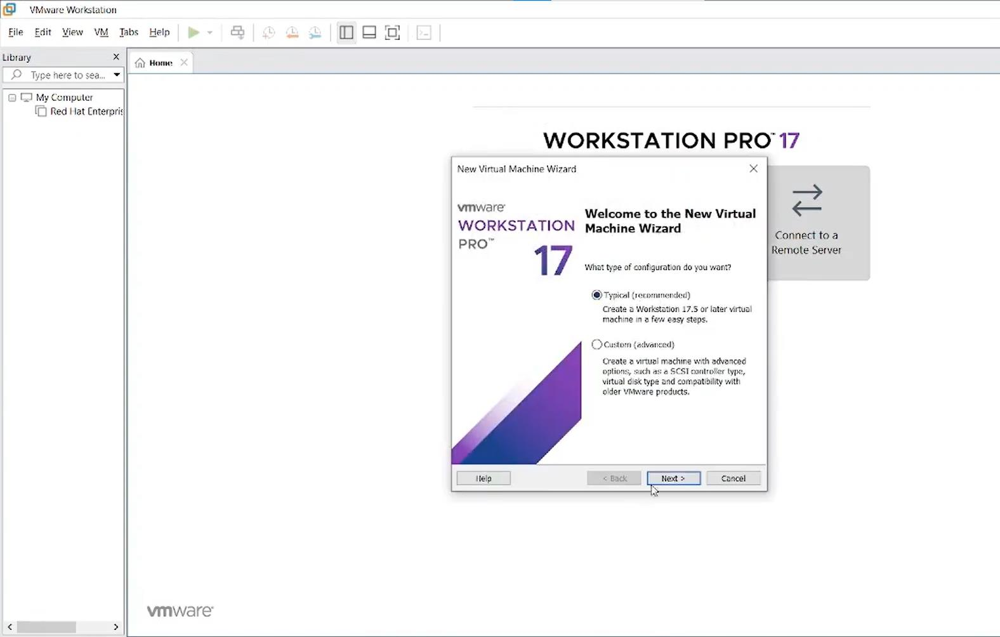

**2.** En **Guest Operating System Installation**, seleccionamos **Installer disc image file (ISO)** y elegimos la imagen `rhel-8.9-x86_64-dvd.iso`. VMware detecta automáticamente que es Red Hat Enterprise Linux de 64 bits y ofrece usar **Easy Install**, su asistente de instalación automática.

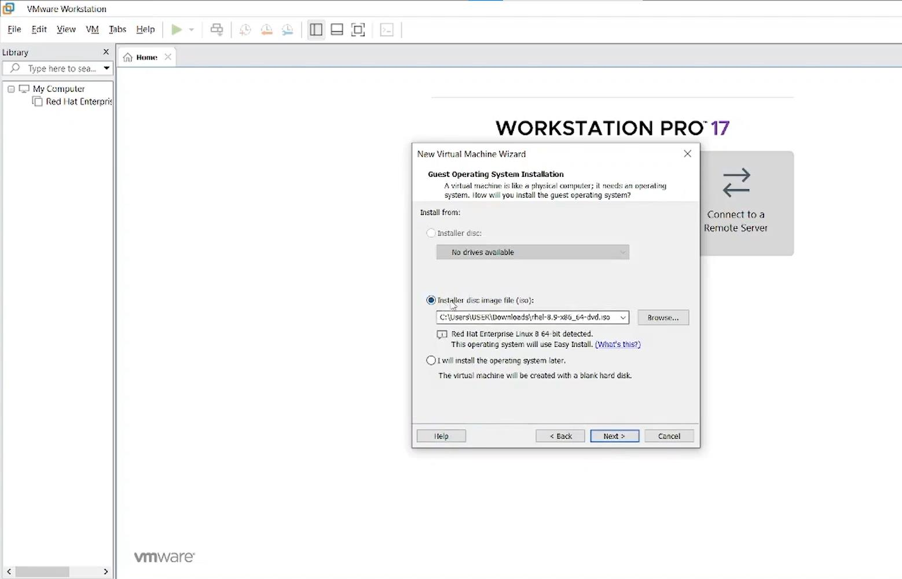

**3.** Asignamos el nombre a la máquina virtual y la ubicación donde se guardará.

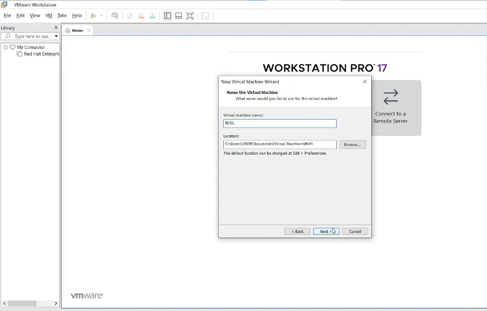

**4.** Especificamos la capacidad del disco virtual.

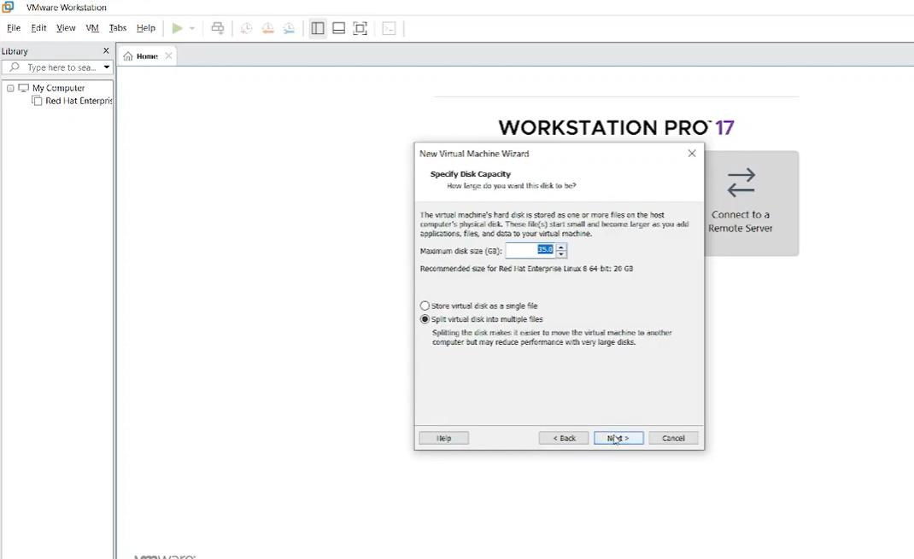

**5.** Revisamos el resumen de la configuración y confirmamos la creación de la máquina virtual.

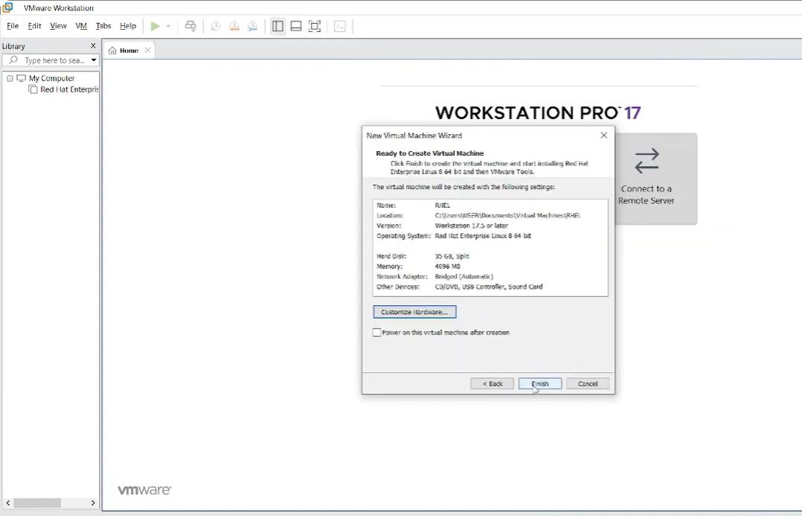

**6.** Antes de iniciarla, entramos a **Edit virtual machine settings** para revisar el hardware. Como VMware generó automáticamente una segunda unidad de CD/DVD con una imagen `autoinst.iso` (el medio que usa **Easy Install** para automatizar la instalación), la removemos.

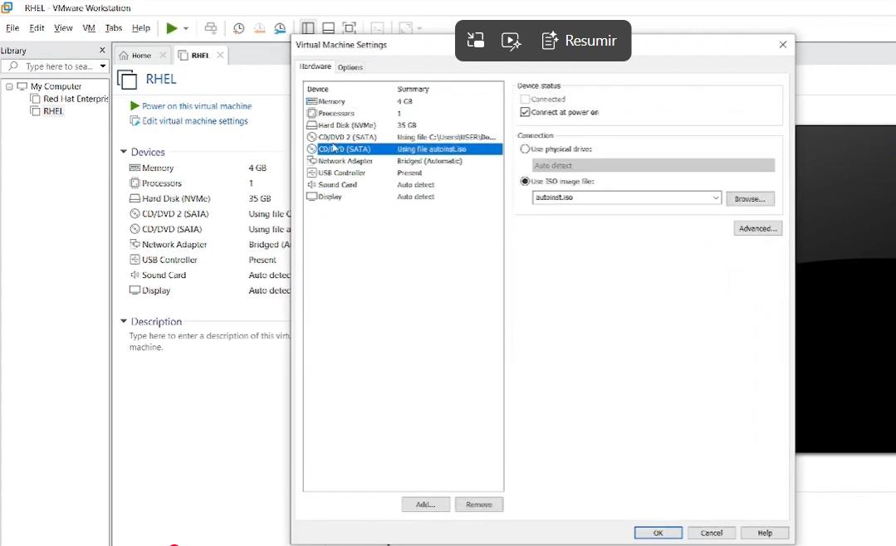

> [!NOTE]
> **Eliminamos el auto installer para evitar errores.** Esto sigue el mismo criterio que la práctica de instalación de Windows Server 2022: dejar que el hipervisor automatice la instalación mediante un medio adicional (el *floppy* de Easy Install en Windows, el `autoinst.iso` en este caso) puede introducir errores durante el proceso. Quitar ese dispositivo antes de arrancar fuerza una instalación manual, estándar y más predecible.

---

## Parte B: Arrancar e instalar RHEL

**1.** Encendemos la máquina virtual. Aparece el menú de arranque de la imagen de instalación de RHEL 8.9, con las opciones para instalar, probar el medio e instalar, o solucionar problemas. El arranque automático continúa a los pocos segundos si no se selecciona nada.

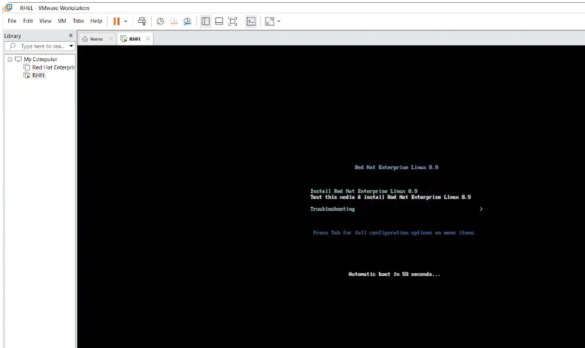

**2.** Se inicia el instalador gráfico de Anaconda. Seleccionamos el idioma que se usará durante el proceso de instalación.

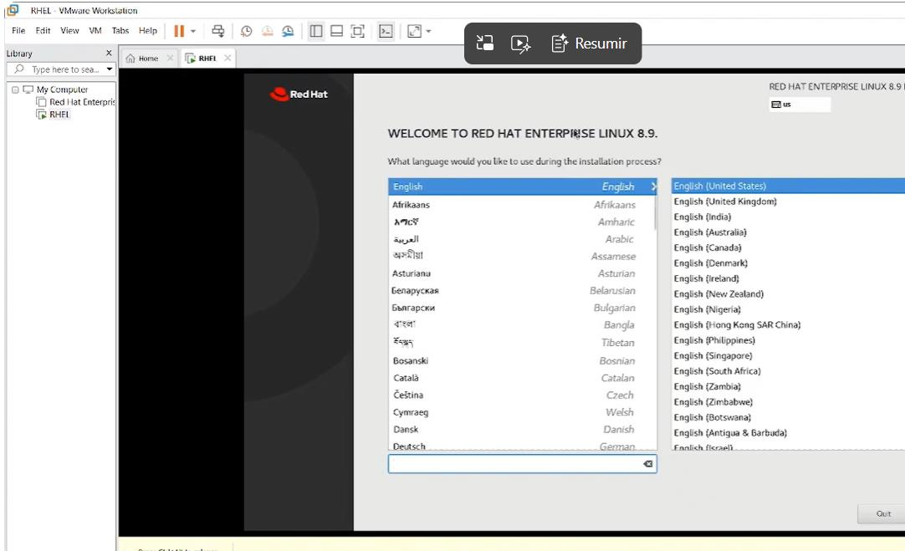

**3.** Llegamos a la pantalla de **Installation Summary**, donde se configuran todas las secciones necesarias antes de instalar: localización (teclado, idioma, fecha y hora), software (origen de la instalación y selección de software) y sistema (destino de la instalación, red y nombre de host, política de seguridad), además de la configuración de usuarios (contraseña de `root` y creación de un usuario).

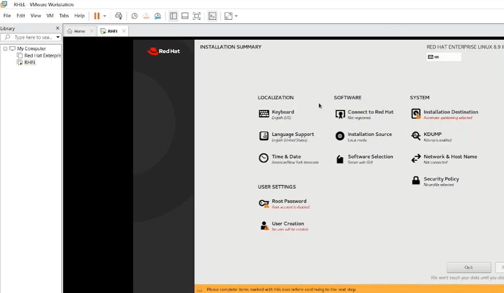

> [!NOTE]
> Cada sección de esta pantalla debe completarse (el instalador marca con un ícono de advertencia las que faltan) antes de poder continuar con el botón **Begin Installation**.

**4.** Una vez completadas todas las secciones, iniciamos la instalación y esperamos a que finalice.

---

## Parte C: Primer inicio del sistema

**1.** Al reiniciar por primera vez tras la instalación, se presenta la pantalla de configuración inicial (**Initial Setup**), donde se revisan la información de la licencia y el gestor de suscripciones de Red Hat.

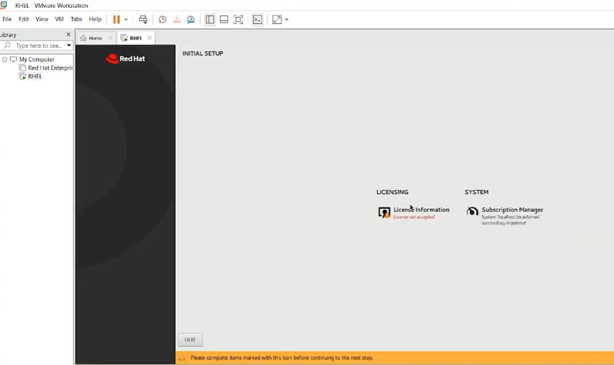

**2.** Completados estos pasos, se llega al escritorio de Red Hat Enterprise Linux 8, listo para usarse.

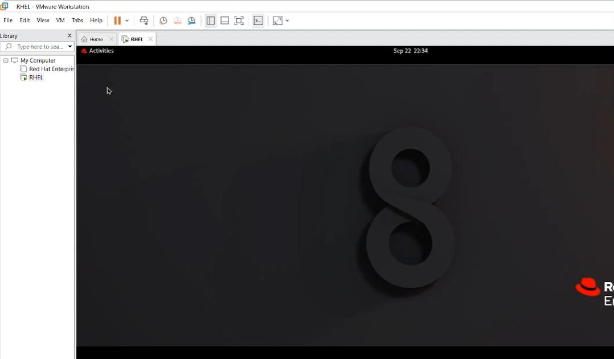

---

## Solución de problemas frecuentes

| Problema | Causa probable | Solución |
|---|---|---|
| La instalación falla o se comporta de forma inesperada al arrancar | Queda conectada la unidad de CD/DVD con `autoinst.iso` (Easy Install) | Quitar ese dispositivo desde **Edit virtual machine settings** antes de encender la máquina virtual |
| El botón **Begin Installation** permanece deshabilitado | Alguna sección del **Installation Summary** no se completó | Revisar las secciones marcadas con el ícono de advertencia (usualmente la contraseña de `root` o la creación de usuario) |
| El sistema no completa la activación o el registro | La información de la suscripción de Red Hat no se completó en **Initial Setup** | Completar la sección de **Subscription Manager**, o registrar el sistema más tarde con `subscription-manager register` |

---

[← Volver al laboratorio](../README.md)
