[← Volver al laboratorio](../README.md)

# 01 · Administración de usuarios y permisos en RHEL


Primera práctica de la materia de Sistemas Operativos (RHEL). Cubre la gestión completa del ciclo de vida de usuarios y grupos en Linux: creación, agrupación, privilegios con `sudo` mediante el archivo `/etc/sudoers`, eliminación y administración de contraseñas.

## Objetivos

| Punto | Descripción |
|:--:|---|
| **A** | Crear 6 usuarios siguiendo la nomenclatura: primera letra del nombre + apellido |
| **B** | Crear los grupos `estudiantes` y `pruebas`, y añadir los 6 usuarios a ambos |
| **C** | Crear el usuario `profesor` y el grupo `docentes` |
| **D** | Habilitar privilegios de `sudo` para el usuario `profesor` y el grupo `docentes` editando `/etc/sudoers` |
| **E** | Retirar los usuarios del grupo `pruebas` y eliminar el grupo |
| **F** | Eliminar uno de los 6 usuarios creados |
| **G** | Añadir uno de los 5 usuarios restantes al grupo `docentes` y verificar que obtiene privilegios de `sudo` |
| **H** | Cambiar la contraseña de los usuarios creados |

## Entorno

| Elemento | Valor |
|---|---|
| Distribución | RHEL (Red Hat Enterprise Linux) |
| Acceso | Terminal local, usuario `Neury0829` con acceso a `root` mediante `su` |
| Usuarios creados | `nmontero`, `amejia`, `jmontero`, `jmarte`, `jirrizarri`, `smontero`, `profesor` |
| Grupos creados | `estudiantes`, `pruebas` (temporal), `docentes` |

## Índice

- [Parte A: Crear seis usuarios](#parte-a-crear-seis-usuarios)
- [Parte B: Crear los grupos y añadir los usuarios](#parte-b-crear-los-grupos-y-añadir-los-usuarios)
- [Parte C: Usuario profesor y grupo docentes](#parte-c-usuario-profesor-y-grupo-docentes)
- [Parte D: Privilegios de sudo en /etc/sudoers](#parte-d-privilegios-de-sudo-en-etcsudoers)
- [Parte E: Retirar usuarios del grupo pruebas y eliminarlo](#parte-e-retirar-usuarios-del-grupo-pruebas-y-eliminarlo)
- [Parte F: Eliminar un usuario](#parte-f-eliminar-un-usuario)
- [Parte G: Añadir un usuario a docentes y verificar sudo](#parte-g-añadir-un-usuario-a-docentes-y-verificar-sudo)
- [Parte H: Cambiar las contraseñas](#parte-h-cambiar-las-contraseñas)
- [Demostración en video](#demostración-en-video)
- [Referencia de comandos](#referencia-de-comandos)
- [Lo aprendido](#lo-aprendido)
- [Solución de problemas](#solución-de-problemas-frecuentes)

---

## Parte A: Crear seis usuarios

Partimos de la terminal de RHEL, con el usuario `Neury0829`.

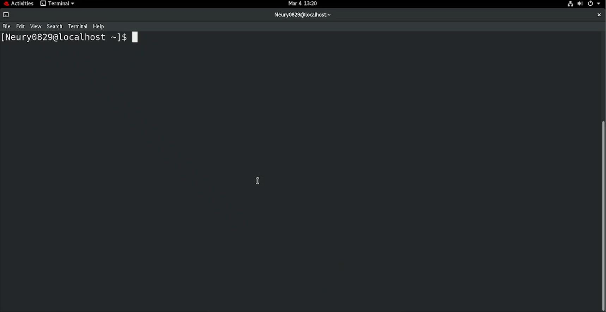


**1.** Ejecutamos `su` para entrar en modo root. Se solicita la contraseña.

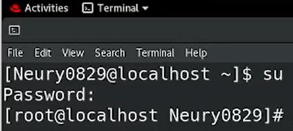


**2.** Para crear un usuario en Linux se usa el comando `useradd`. Al estar ya en `root`, no es necesario anteponer `sudo`. La bandera `-m` indica que se debe crear también el directorio *home* del usuario:

```bash
useradd -m nmontero
```

**3.** Repetimos el procedimiento para los seis usuarios, siguiendo la nomenclatura *primera letra del nombre + apellido* (`nmontero`, `amejia`, `jmontero`, `jmarte`, `jirrizarri`, `smontero`). Con la flecha hacia arriba del teclado se reutiliza el comando anterior y solo se cambia el nombre.

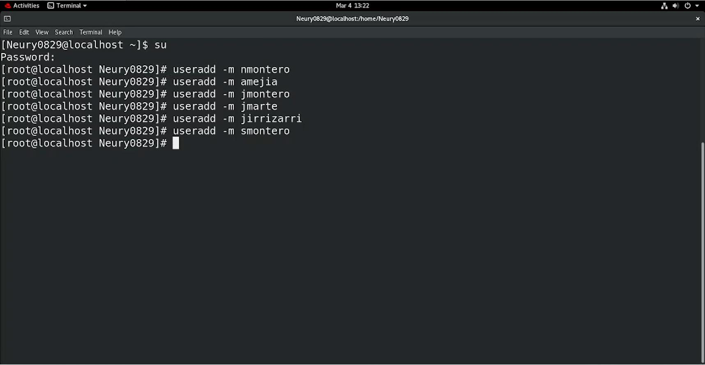


**4.** Para confirmar que los usuarios se crearon correctamente, revisamos el archivo `/etc/passwd`:

```bash
cat /etc/passwd
```

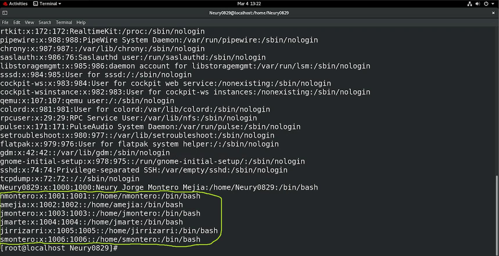


Los seis usuarios aparecen al final del archivo, cada uno con su propio directorio *home* y la shell `/bin/bash`.

---

## Parte B: Crear los grupos y añadir los usuarios

**1.** Creamos los grupos `estudiantes` y `pruebas` con `groupadd`:

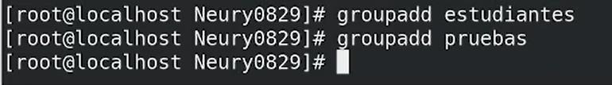


**2.** Confirmamos con `cat /etc/group` que ambos grupos se crearon correctamente.

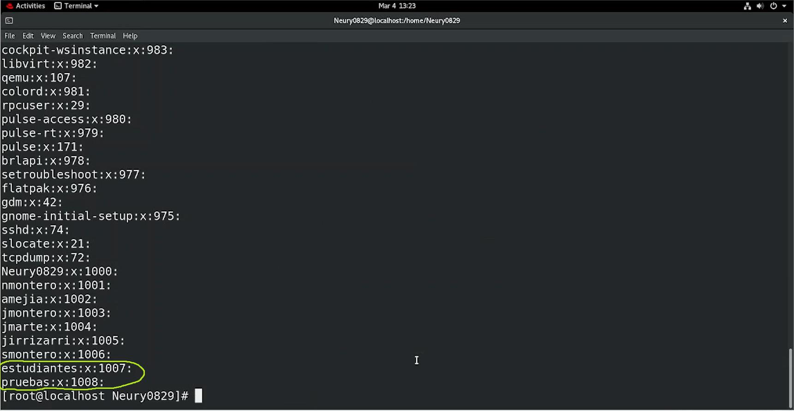


**3.** Para incorporar cada usuario a un grupo se usa `usermod -aG <grupo> <usuario>`. La bandera `-aG` agrega (`-a`, *append*) el grupo como **secundario** del usuario, sin reemplazar su grupo primario. Repetimos el procedimiento con los seis usuarios para el grupo `estudiantes`...

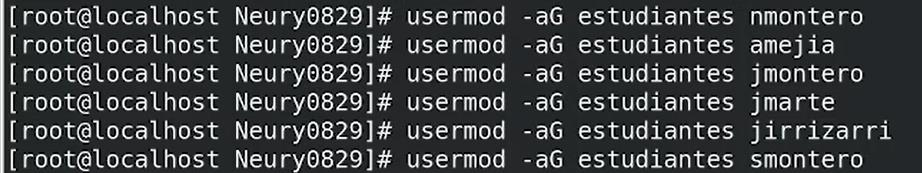


...y luego para el grupo `pruebas`.

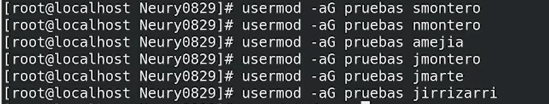


**4.** Verificamos con `cat /etc/group` que los seis usuarios quedaron incorporados a ambos grupos.

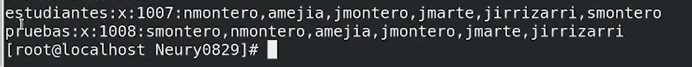


> [!TIP]
> Omitir la bandera `-a` en `usermod -G` **reemplaza** todos los grupos secundarios del usuario por el que se especifica, en vez de añadirlo. Por eso `-aG` es la forma segura de agregar un usuario a un grupo adicional.

---

## Parte C: Usuario profesor y grupo docentes

**1.** Repetimos el procedimiento de las partes anteriores para crear el usuario `profesor` y el grupo `docentes`:

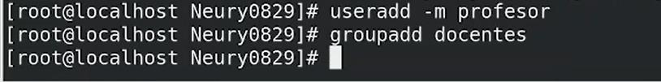


**2.** Confirmamos la creación del grupo con `cat /etc/group`.

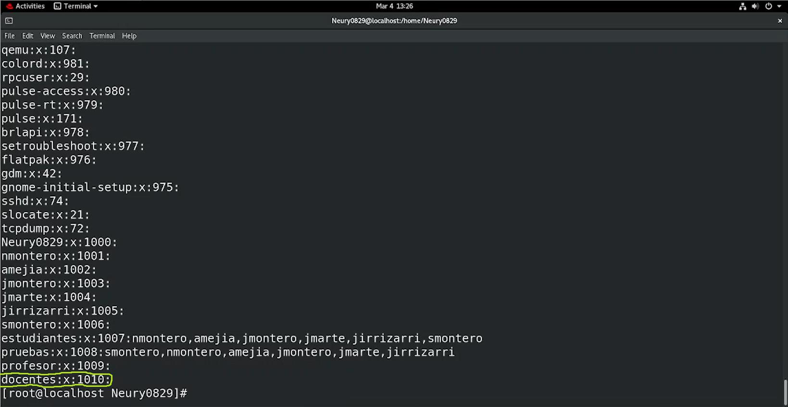


**3.** Confirmamos la creación del usuario con `cat /etc/passwd`.

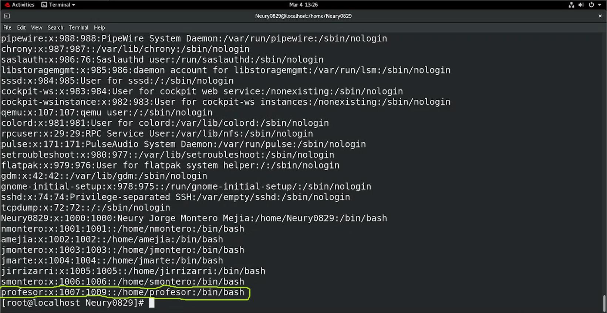


---

## Parte D: Privilegios de sudo en /etc/sudoers

**1.** Editamos el archivo de configuración de `sudo` con el editor `nano`:

```bash
nano /etc/sudoers
```

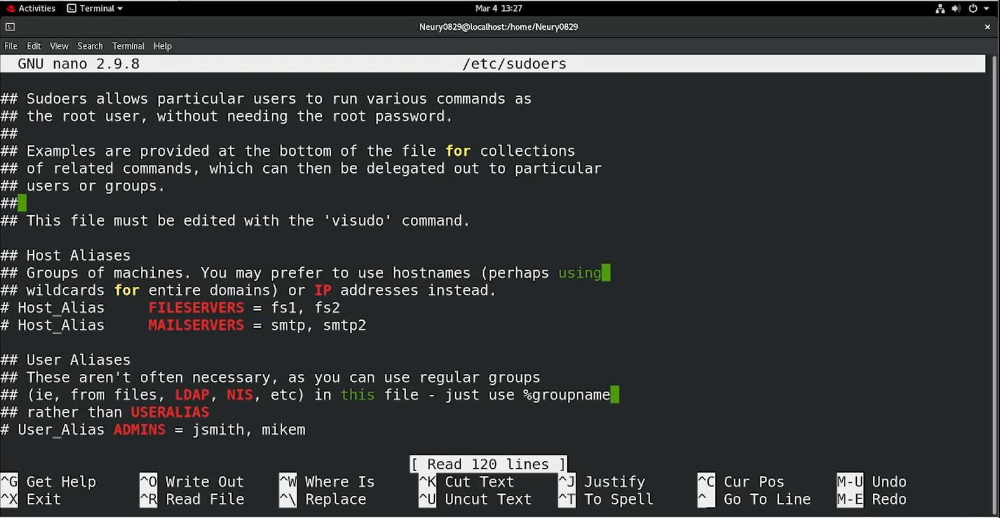


**2.** Al final del archivo, agregamos dos entradas: una para el usuario `profesor` y otra para el grupo `docentes` (anteponiendo `%` al nombre del grupo). `ALL=(ALL) ALL` otorga privilegios completos de `sudo`:

```text
profesor ALL=(ALL)     ALL
%docentes ALL=(ALL)    ALL
```

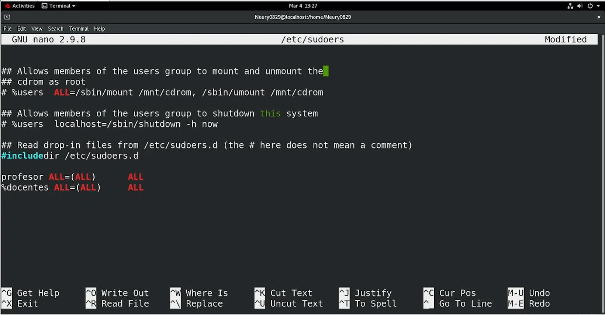


> [!NOTE]
> El `%` antes del nombre indica que la entrada aplica a un **grupo**, no a un usuario individual. Con esto, cualquier usuario que pertenezca a `docentes` obtiene privilegios de `sudo` automáticamente.

**3.** Guardamos los cambios con `Ctrl + O`, `Enter` y salimos con `Ctrl + X`.

**4.** Confirmamos que la configuración se guardó correctamente:

```bash
cat /etc/sudoers
```

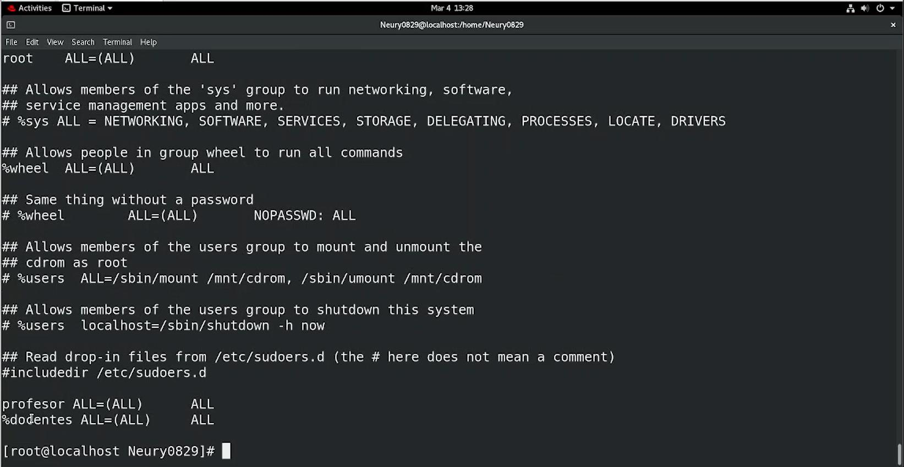


> [!WARNING]
> Editar `/etc/sudoers` directamente con un editor de texto (en vez de con `visudo`) es riesgoso: un error de sintaxis puede dejar el archivo inválido y bloquear el uso de `sudo` en todo el sistema. El propio archivo lo advierte: *"This file must be edited with the 'visudo' command"*. `visudo` valida la sintaxis antes de guardar.

---

## Parte E: Retirar usuarios del grupo pruebas y eliminarlo

**1.** Para quitar un usuario de un grupo (sin eliminar al usuario) se usa `gpasswd -d <usuario> <grupo>`, donde `-d` significa *delete*:

```bash
gpasswd -d nmontero pruebas
```

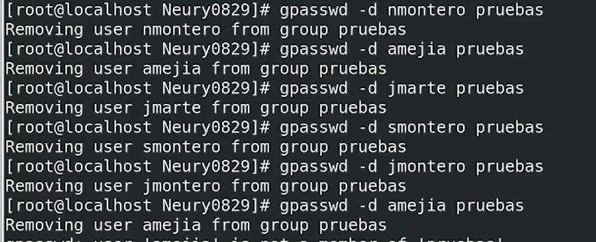


**2.** Repetimos el procedimiento para los seis usuarios del grupo `pruebas`.

**3.** Con el grupo ya sin miembros, lo eliminamos con `groupdel`:

```bash
groupdel pruebas
```


**4.** Confirmamos con `cat /etc/group` que el grupo `pruebas` ya no existe.

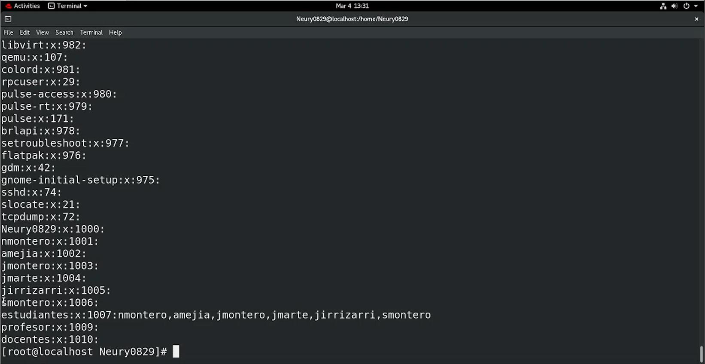


---

## Parte F: Eliminar un usuario

**1.** Para eliminar un usuario se usa `userdel` seguido del nombre. En este caso, eliminamos a `jirrizarri`:

```bash
userdel jirrizarri
```

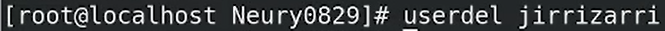


**2.** Confirmamos con `cat /etc/passwd` que el usuario ya no aparece en el sistema.

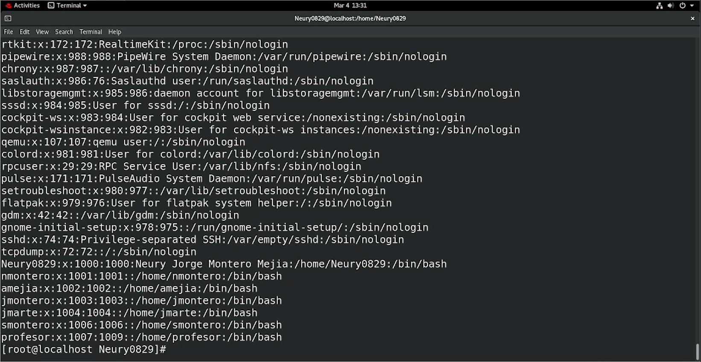


> [!NOTE]
> `userdel` por sí solo no elimina el directorio *home* del usuario. Para eliminarlo también, se usa `userdel -r <usuario>`.

---

## Parte G: Añadir un usuario a docentes y verificar sudo

**1.** Incorporamos a `nmontero` (uno de los cinco usuarios restantes) al grupo `docentes`:

```bash
usermod -aG nmontero docentes
```


**2.** Confirmamos con `cat /etc/group` que `nmontero` se incorporó correctamente a `docentes`.

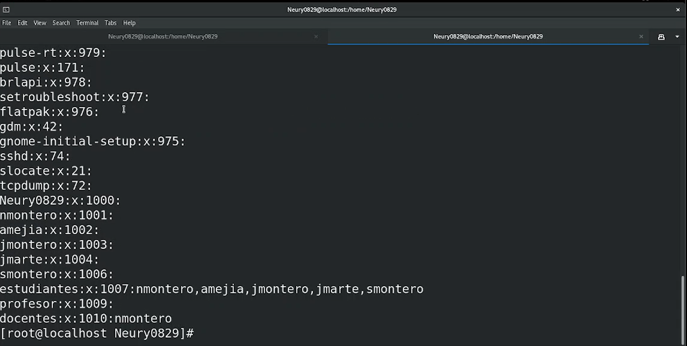


**3.** Para comprobar que el usuario obtuvo privilegios de `sudo`, primero le asignamos una contraseña con `passwd`:

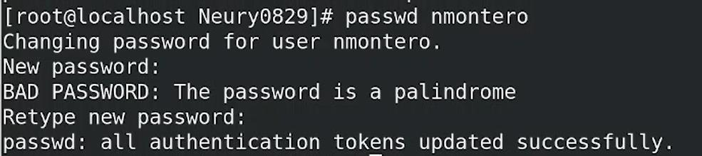


**4.** Accedemos al usuario con `su - nmontero` (el guion carga también su entorno, no solo la identidad).

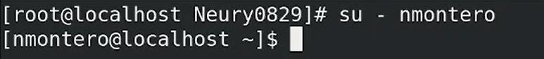


**5.** Verificamos los privilegios de `sudo` con `sudo su`, que eleva la sesión a `root` solicitando la contraseña del propio usuario:

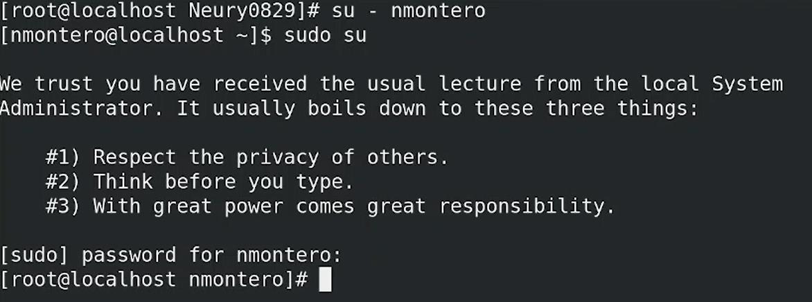


**6.** Confirmamos el cambio de identidad con `whoami`:

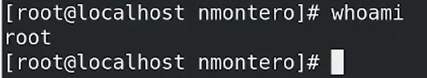


El resultado `root` confirma que `nmontero` heredó los privilegios de `sudo` al pertenecer al grupo `docentes`, tal como se definió en la Parte D.

---

## Parte H: Cambiar las contraseñas

> [!NOTE]
> El documento original de esta práctica numera este punto como "Punto i", saltando la letra "h". Se conserva como **Parte H** por orden, ya que es el último punto de la guía.

**1.** Se utiliza el comando `passwd` seguido del nombre de usuario para establecer o cambiar su contraseña. Repetimos el procedimiento para cada uno de los usuarios restantes.

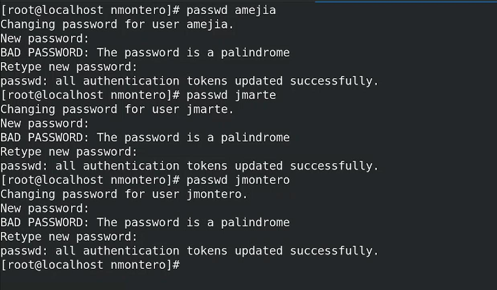

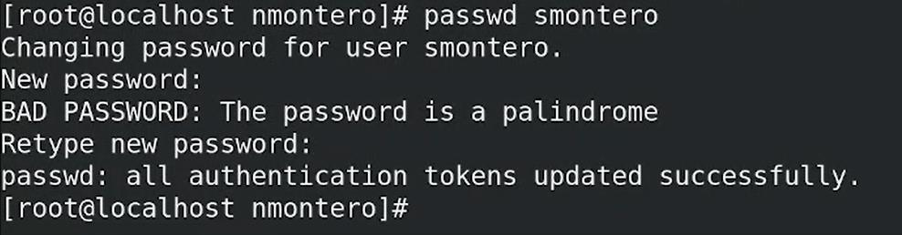


> [!TIP]
> El sistema advierte *"BAD PASSWORD: The password is a palindrome"* porque las contraseñas usadas en el laboratorio eran palíndromos (se leen igual al derecho y al revés), un patrón fácil de adivinar. Es solo una advertencia de política de calidad; en RHEL, `root` puede igualmente forzar la contraseña. En un entorno real conviene usar una contraseña robusta y sin patrones predecibles.

---
## Demostración complementaria: sudoers con visudo

Esta demostración adicional repite el flujo de usuarios, grupos y privilegios de `sudo`, pero usando **`visudo`** en vez de `nano` para editar `/etc/sudoers`, tal como se recomendó en la Parte D.

**1.** Creamos un usuario y le asignamos una contraseña:

```bash
adduser Neury
passwd Neury
```

Para editar los privilegios de `sudo`, en vez de abrir el archivo directamente con un editor de texto, usamos `visudo`:

```bash
sudo visudo
```

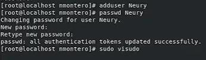

**2.** `visudo` abre el archivo `/etc/sudoers` en un editor (por defecto, `vi`), con sus comentarios explicativos sobre la sintaxis y las secciones predefinidas (`%wheel`, `%users`, etc.).

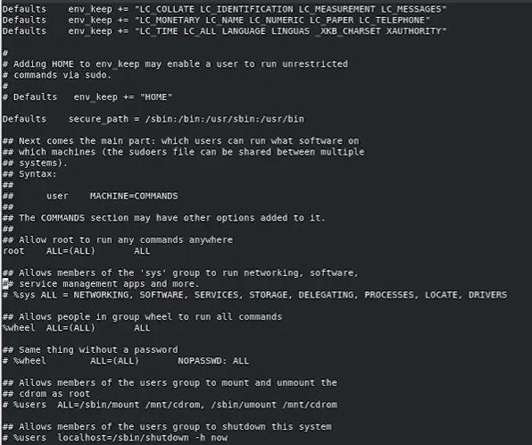

**3.** Al final del archivo, agregamos una línea otorgando privilegios completos al usuario `Neury`, siguiendo el mismo formato que la línea de `root`:

```text
root   ALL=(ALL)     ALL
Neury  ALL=(ALL)     ALL
```

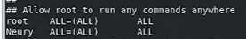

**4.** Guardamos y salimos con la combinación de `vi`: `Esc` y `:wq`.


> [!TIP]
> `visudo` bloquea el archivo mientras se edita (evitando que dos personas lo editen a la vez) y, lo más importante, **valida la sintaxis antes de guardar**. Si hay un error, avisa y permite corregirlo antes de aplicar el cambio, en vez de dejar el archivo roto como podría pasar al editarlo directamente con `nano`.

**5.** Verificamos el acceso del nuevo usuario con `su -` (que carga también su entorno), y volvemos a la sesión original con `exit`:

```bash
su - Neury
exit
```

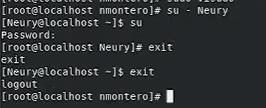

### Grupo adicional: guest

**6.** Creamos un segundo usuario (`Pablo`), un grupo (`guest`) y agregamos a `Pablo` como miembro secundario del grupo:

```bash
adduser Pablo
groupadd guest
usermod -aG guest Pablo
cat /etc/group
```

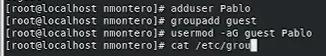

El resultado confirma que `guest` quedó creado con `Pablo` como miembro:

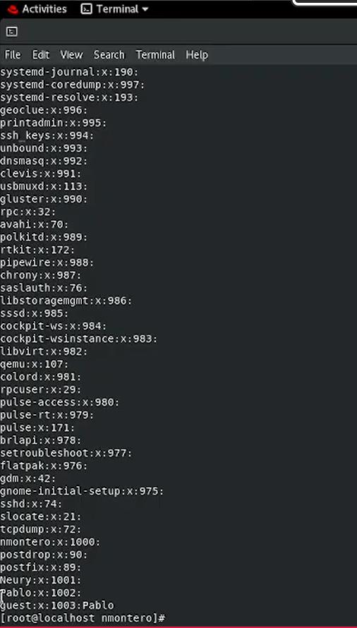

**7.** Para confirmar un grupo específico sin revisar el archivo completo, se puede filtrar la salida con `grep`:

```bash
cat /etc/group | grep guest
```

```text
guest:x:1003:Pablo
```

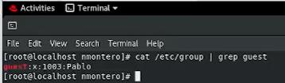

**8.** Para limpiar el entorno, eliminamos el usuario y el grupo creados:

```bash
userdel Pablo
groupdel guest
```

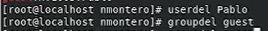

---
## Demostración complementaria: permisos de archivos con chmod

Esta demostración trabaja la otra mitad del tema de la práctica: los **permisos sobre archivos**, usando la notación simbólica de `chmod` (en vez de la numérica), junto con operaciones básicas de archivos y directorios.

**1.** Creamos un directorio de trabajo y un archivo de texto, y lo abrimos con el editor `vi`:

```bash
cd Desktop
mkdir materia
cd materia
touch estudiante.txt
vi estudiante.txt
```

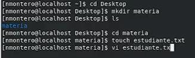

**2.** Dentro de `vi`, escribimos un par de líneas de contenido y guardamos:

```text
Neury Jorge Montero Mejia
2025-0829
```

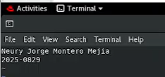

**3.** Revisamos el contenido con `cat` (que lo muestra en orden normal) y con `tac` (que lo muestra con las líneas en orden inverso, de ahí su nombre: "cat" al revés):

```bash
cat estudiante.txt
tac estudiante.txt
```

Después, cambiamos a la cuenta de `root` con `su` y revisamos los permisos actuales del archivo con `ls -l`:

```bash
su
ls -l
```

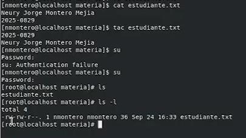

Los permisos iniciales del archivo son `-rw-rw-r--`: lectura y escritura para el propietario y el grupo, y solo lectura para el resto.

> [!NOTE]
> En la captura, el primer intento de `su` falla con *"Authentication failure"* antes de tener éxito en el segundo intento, por una contraseña mal escrita.

**4.** Modificamos los permisos con `chmod`, usando la notación **simbólica** (`u` para el propietario, `g` para el grupo, `o` para el resto, `+`/`-` para agregar o quitar permisos):

```bash
chmod 700 estudiante.txt
ls -l
```
```text
-rwx------
```

```bash
chmod 000 estudiante.txt
chmod g+rwx estudiante.txt
ls -l
```
```text
----rwx---
```

```bash
chmod u+rwx estudiante.txt
ls -l
```
```text
-rwxrwx---
```

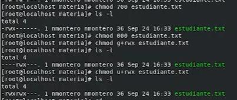

> [!TIP]
> `chmod 700` usa notación **numérica** (lectura=4, escritura=2, ejecución=1, sumados por cada grupo: propietario/grupo/otros). Los pasos siguientes usan notación **simbólica** (`u`, `g`, `o`, `a` + `+`/`-`/`=` + `r`/`w`/`x`), que es más práctica para modificar un solo permiso sin tener que recalcular el número completo cada vez.

**5.** Creamos un segundo directorio y copiamos el archivo hacia él con `cp`:

```bash
mkdir materia2
ls
cd materia2
cp materia/estudiante.txt materia2
```

El primer intento falla (`cannot stat 'materia/estudiante.txt'`), porque ya estábamos dentro de `materia2`, así que la ruta relativa `materia/estudiante.txt` no existe ahí.

```bash
cd ..
cp materia/estudiante.txt materia2
cd materia2
ls
```

Repitiéndolo desde `Desktop` (un nivel arriba), la ruta relativa sí es correcta y la copia funciona.

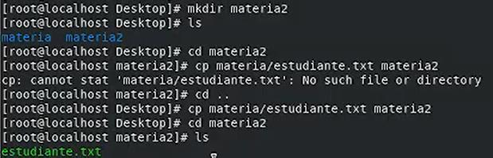

**6.** Para terminar, intentamos ver el archivo con un nombre mal escrito, lo corregimos, y eliminamos el directorio original (`materia`) de forma recursiva con `rm -r`:

```bash
cat estudiate.txt
```
```text
cat: estudiate.txt: No such file or directory
```

```bash
cat estudiante.txt
cd ..
rm -r materia
```

`rm -r` pregunta por cada elemento antes de eliminarlo (el directorio y el archivo que contiene). Confirmamos con `yes` en cada caso.

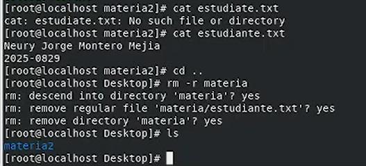

---

## Referencia de comandos

| Comando | Función |
|---|---|
| `su` | Cambia a otro usuario (por defecto, a `root`) |
| `su - <usuario>` | Cambia de usuario cargando también su entorno (variables, directorio *home*) |
| `useradd -m <usuario>` | Crea un usuario con su directorio *home* |
| `userdel <usuario>` | Elimina un usuario (`-r` elimina también su *home*) |
| `groupadd <grupo>` | Crea un grupo |
| `groupdel <grupo>` | Elimina un grupo |
| `usermod -aG <grupo> <usuario>` | Agrega un usuario a un grupo secundario |
| `gpasswd -d <usuario> <grupo>` | Retira a un usuario de un grupo |
| `passwd <usuario>` | Establece o cambia la contraseña de un usuario |
| `cat /etc/passwd` | Lista los usuarios del sistema |
| `cat /etc/group` | Lista los grupos del sistema y sus miembros |
| `nano /etc/sudoers` / `visudo` | Edita los privilegios de `sudo` |
| `whoami` | Muestra el usuario con el que se está operando actualmente |

---

## Lo aprendido

Esta práctica permitió trabajar el ciclo de vida completo de usuarios y grupos en Linux: creación, agrupación, asignación de privilegios administrativos y eliminación, usando los comandos estándar de administración de RHEL.

Se comprendió la diferencia entre el grupo primario y los grupos secundarios de un usuario (y por qué `usermod -aG` es la forma correcta de añadir un grupo sin reemplazar los existentes), cómo delegar privilegios de `sudo` a nivel de usuario y de grupo mediante `/etc/sudoers`, y por qué ese archivo debería editarse con `visudo` para evitar dejarlo en un estado inválido. También se verificó de forma práctica, con `sudo su` y `whoami`, que la pertenencia a un grupo con privilegios en `sudoers` otorga esos privilegios de forma automática a cualquier usuario que se agregue después.

## Demostración en video

Esta práctica cuenta con una demostración en video donde se muestra el proceso completo en el laboratorio. Las capturas del procedimiento se encuentran en la carpeta `images/`.

**Video de la práctica (PRIMERA PARTE):** [Ver demostración en YouTube](https://www.youtube.com/watch?v=8s3UGKai9P4&list=PLIJEt4hLYnOUAQxFim_nNNvPqBw8Z8VKT)

**Video de la demostración complementaria (sudoers con visudo):** [Ver demostración en YouTube](https://www.youtube.com/watch?v=0q4Phl2d24I&list=PLIJEt4hLYnOVlwzFyi3vGdJAej-IfKZvR&index=2)

**Video de la segunda demostración complementaria (permisos con chmod):** [Ver demostración en YouTube](https://www.youtube.com/watch?v=pkG0VfYP414&list=PLIJEt4hLYnOVlwzFyi3vGdJAej-IfKZvR&index=1)

---

## Solución de problemas frecuentes

| Problema | Causa probable | Solución |
|---|---|---|
| `useradd: user already exists` | El usuario ya fue creado antes | Verificar con `cat /etc/passwd` antes de crearlo de nuevo |
| El usuario no tiene directorio *home* | Se omitió la bandera `-m` en `useradd` | Volver a crear el usuario con `-m`, o crear el directorio manualmente con `mkhomedir_helper` |
| `sudo` no reconoce a un usuario recién agregado al grupo | La sesión del usuario es anterior a la actualización del grupo | Cerrar sesión y volver a iniciarla, o usar `su - <usuario>` después del cambio |
| El archivo `/etc/sudoers` no permite guardar o deja sin acceso a `sudo` | Error de sintaxis al editarlo directamente | Editar siempre con `visudo`, que valida la sintaxis antes de aplicar los cambios |
| `groupdel` no permite eliminar el grupo | El grupo es el grupo primario de algún usuario | Verificar con `cat /etc/passwd` y cambiar el grupo primario de ese usuario antes de eliminarlo |

---

[← Volver al laboratorio](../README.md)
