[← Volver al laboratorio](../README.md)

# 02 · Antivirus ClamAV: instalación, actualización y escaneos programados


Instalación y configuración de **ClamAV**, un motor antivirus de código abierto, en RHEL: habilitación de los repositorios necesarios, actualización automática de firmas con FreshClam, escaneos programados con `cron` y revisión de los registros generados.

## Objetivos

| Punto | Descripción |
|:--:|---|
| **A** | Implementar ClamAV en una distribución de preferencia |
| **B** | Configurar las actualizaciones automáticas de la base de firmas |
| **C** | Configurar los escaneos periódicos |
| **D** | Mostrar los *logs* generados por ClamAV |

## Entorno

| Elemento | Valor |
|---|---|
| Distribución | RHEL (Red Hat Enterprise Linux) |
| Gestor de paquetes | `dnf` |
| Repositorios requeridos | CodeReady Builder (CRB) y EPEL |
| Componentes instalados | `clamav`, `clamd`, `clamav-update` |
| Servicio de actualización de firmas | `clamav-freshclam` |
| Script de escaneo | `/usr/local/bin/escaneo_clamav.sh` |
| Log de escaneos | `/var/log/clamav_scan.log` |

## Índice

- [Parte A: Implementar ClamAV](#parte-a-implementar-clamav)
- [Parte B: Actualizaciones automáticas](#parte-b-actualizaciones-automáticas)
- [Parte C: Escaneos periódicos con cron](#parte-c-escaneos-periódicos-con-cron)
- [Parte D: Logs generados por ClamAV](#parte-d-logs-generados-por-clamav)
- [Referencia de comandos y archivos](#referencia-de-comandos-y-archivos)
- [Lo aprendido](#lo-aprendido)
- [Solución de problemas frecuentes](#solución-de-problemas-frecuentes)

---

## Parte A: Implementar ClamAV

**1.** Actualizamos los repositorios a su versión más reciente (con privilegios de `sudo`):

```bash
dnf update -y
```

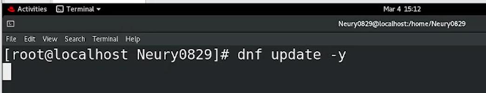


**2.** Activamos el repositorio **CodeReady Builder (CRB)**, donde se encuentran varias dependencias de ClamAV. En algunas distribuciones ya viene activado por defecto.

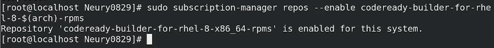


**3.** Instalamos el repositorio **EPEL** (*Extra Packages for Enterprise Linux*), donde se encuentra el paquete de ClamAV:

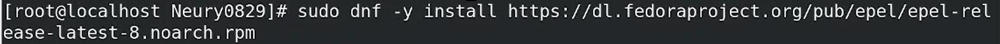


> [!IMPORTANT]
> Es importante activar el repositorio CodeReady Builder **antes** de instalar EPEL, porque muchos de sus paquetes dependen de él.

**4.** Actualizamos nuevamente los repositorios, ya con CRB y EPEL habilitados:

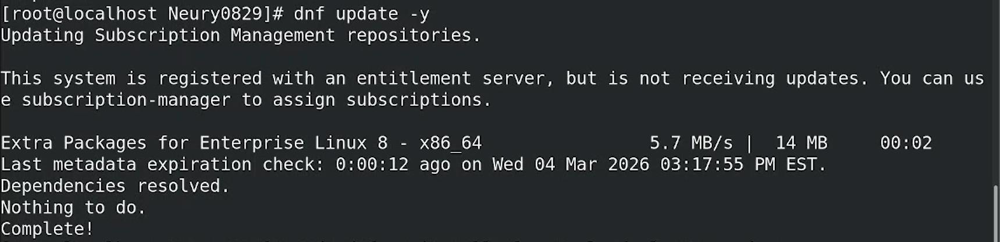


**5.** Instalamos ClamAV y sus componentes:

```bash
sudo dnf -y install clamav clamd clamav-update
```

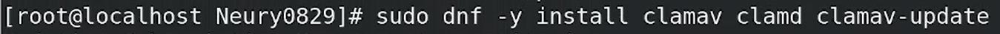


**6.** Validamos que la instalación se completó correctamente:

```bash
clamscan --version
```

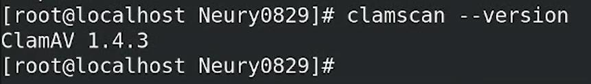


> [!NOTE]
> ClamAV incluye dos herramientas principales: **ClamScan**, que es la que se acaba de instalar y realiza los escaneos en busca de virus, y **FreshClam**, que actualiza la base de firmas que ClamScan utiliza para detectarlos.

**7.** Ejecutamos FreshClam para descargar la base de firmas por primera vez:

```bash
sudo freshclam
```

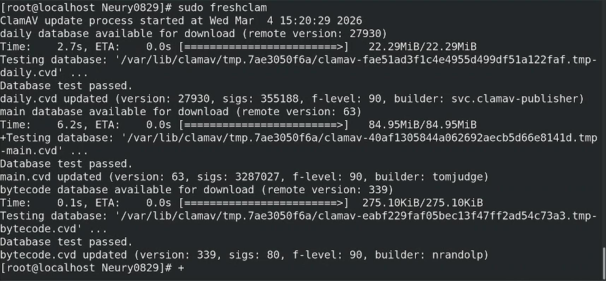


**8.** Creamos el archivo de log de FreshClam y le asignamos los permisos necesarios para que pueda administrarlo:

```bash
touch /var/log/freshclam.log
```

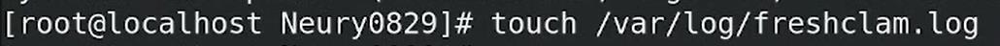


```bash
chmod 600 /var/log/freshclam.log
chown root /var/log/freshclam.log
```

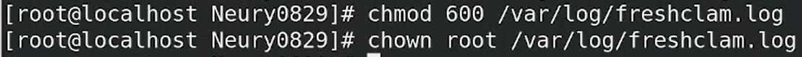


**9.** Activamos el servicio de FreshClam:

```bash
systemctl start clamav-freshclam.service
```

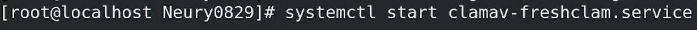


**10.** Para verificar que se activó correctamente, repetimos el comando anterior cambiando `start` por `status`:

```bash
systemctl status clamav-freshclam.service
```

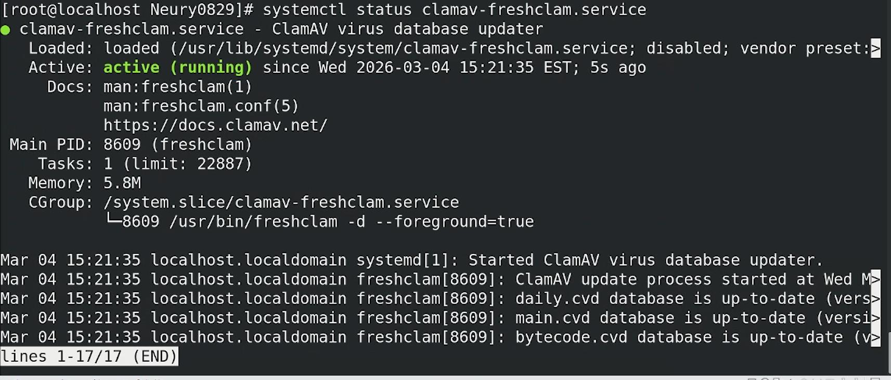


El servicio aparece como `active (running)`, confirmando que se inicializó correctamente.

---

## Parte B: Actualizaciones automáticas

**1.** Entramos a la configuración global de FreshClam:

```bash
nano /etc/freshclam.conf
```

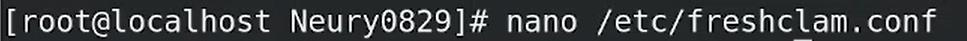


**2.** Buscamos la línea `DatabaseMirror database.clamav.net` y la descomentamos. Esto activa un dominio primario desde el cual se descargan las actualizaciones de la base de firmas.

**3.** Buscamos la línea `UpdateLogFile /var/log/freshclam.log` y la descomentamos. Esto centraliza el registro de las actualizaciones en ese archivo.

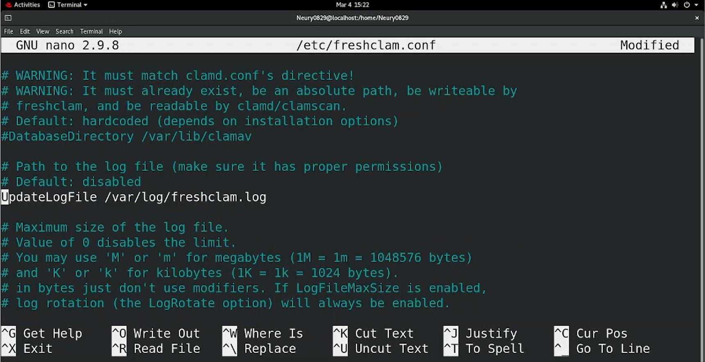


**4.** Guardamos (`Ctrl + O`, `Enter`) y salimos (`Ctrl + X`).

**5.** Habilitamos el servicio para que se inicie automáticamente con el sistema:

```bash
systemctl enable clamav-freshclam
```

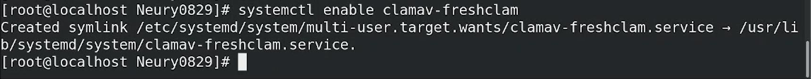


> [!NOTE]
> `systemctl start` inicia el servicio en la sesión actual; `systemctl enable` hace que se inicie automáticamente en cada arranque del sistema. Se necesitan ambos para que las actualizaciones automáticas queden activas de forma permanente.

---

## Parte C: Escaneos periódicos con cron

**1.** Creamos un script para automatizar el proceso de escaneo, en la ruta `/usr/local/bin/`:

```bash
nano /usr/local/bin/escaneo_clamav.sh
```

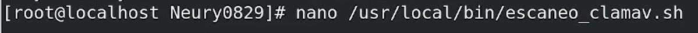


**2.** Establecemos que el archivo se interprete en Bash:

```bash
#!/bin/bash
```

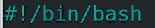


**3.** Escribimos el resto del script:

```bash
#!/bin/bash
LOGFILE="/var/log/clamav_scan.log"
clamscan -r /home /var --move=/quarantine --log=$LOGFILE
```

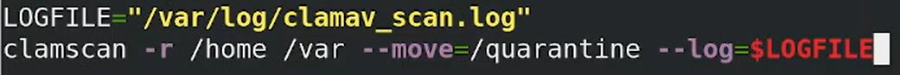


`LOGFILE` define la variable con la ruta del archivo de registro. `clamscan -r` escanea `/home` y `/var` de forma recursiva, `--move=/quarantine` mueve a cuarentena los archivos infectados que se encuentren, y `--log=$LOGFILE` guarda el resultado del escaneo en el archivo de registro, haciéndolo visible más adelante.

**4.** Guardamos (`Ctrl + O`, `Enter`) y salimos (`Ctrl + X`).

**5.** Le damos permisos de ejecución al script:

```bash
chmod +x /usr/local/bin/escaneo_clamav.sh
```

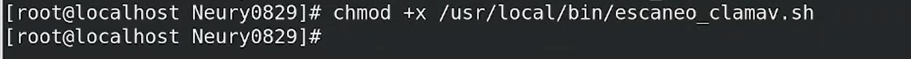


**6.** Configuramos el escaneo periódico con `crontab`:

```bash
sudo crontab -e
```

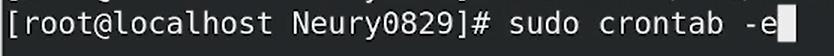


**7.** Presionamos `I` para entrar en modo de inserción (el editor por defecto de `crontab -e` en este sistema es `vi`) y escribimos:

```cron
0 3 * * * /usr/local/bin/escaneo_clamav.sh
```

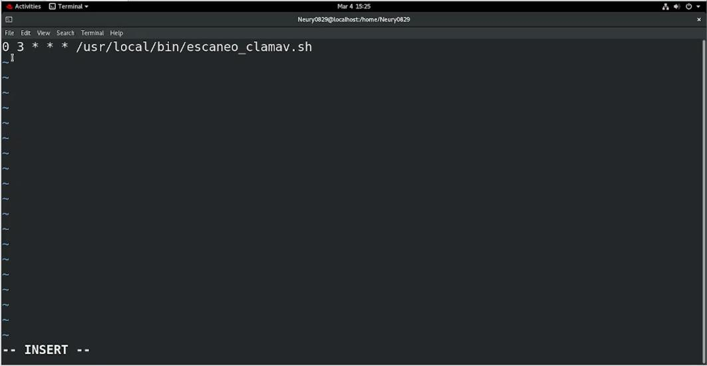


Esta expresión de `cron` ejecuta el script todos los días, sin excepción, a las **3:00 a.m.**

**8.** Presionamos `Esc` y escribimos `:wq` para guardar y salir de `vi`.

> [!TIP]
> La sintaxis de `cron` sigue el orden `minuto hora día-del-mes mes día-de-la-semana`. El asterisco (`*`) significa "cualquier valor". Por eso `0 3 * * *` se lee como *"al minuto 0, de la hora 3, de cualquier día, de cualquier mes, de cualquier día de la semana"*: todos los días a las 3:00 a.m.

---

## Parte D: Logs generados por ClamAV

**1.** Realizamos un escaneo manual al directorio `home`:

```bash
clamscan -r /home
```

**2.** Esperamos a que finalice.

**3.** Al terminar, se muestra el **SCAN SUMMARY** con los detalles del escaneo: virus conocidos, directorios y archivos escaneados, archivos infectados, datos escaneados y el tiempo que tomó.

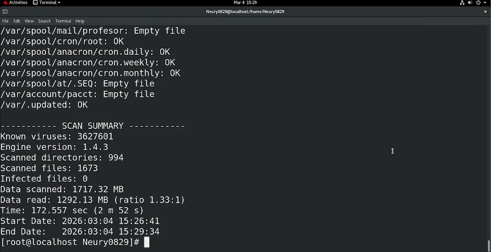


**4.** También se puede consultar el registro guardado por el script programado, usando `cat` en vez de ejecutar `clamscan` de nuevo:

```bash
cat /var/log/clamav_scan.log
```

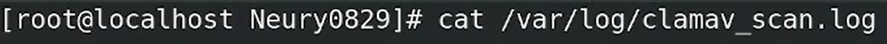

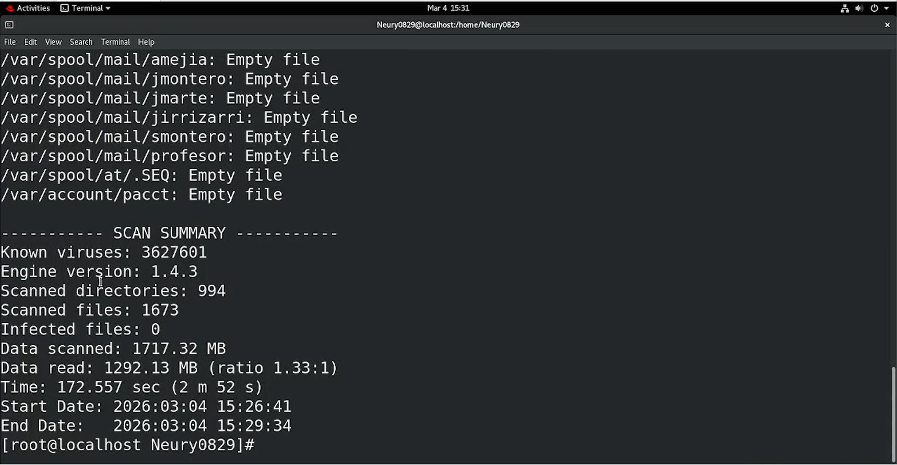


El archivo de log muestra el mismo tipo de resumen (**SCAN SUMMARY**), generado automáticamente la próxima vez que `cron` ejecute el script a las 3:00 a.m.

---

## Referencia de comandos y archivos

| Comando / archivo | Función |
|---|---|
| `dnf update -y` | Actualiza los repositorios y paquetes instalados |
| `subscription-manager repos --enable codeready-builder-for-rhel-*` | Habilita el repositorio CodeReady Builder |
| `dnf install epel-release` | Instala el repositorio EPEL |
| `dnf install clamav clamd clamav-update` | Instala ClamAV y sus componentes |
| `clamscan --version` | Verifica la instalación y la versión de ClamAV |
| `freshclam` | Descarga o actualiza manualmente la base de firmas |
| `systemctl start/enable/status clamav-freshclam` | Inicia, habilita al arranque o consulta el estado del servicio de actualización |
| `/etc/freshclam.conf` | Configuración de FreshClam (mirror de la base de datos, archivo de log) |
| `clamscan -r <ruta>` | Escanea un directorio de forma recursiva |
| `crontab -e` | Edita las tareas programadas del usuario actual |
| `/var/log/clamav_scan.log` | Registro de los escaneos programados |

---

## Lo aprendido

Esta práctica permitió instalar y configurar un antivirus de línea de comandos en RHEL de principio a fin: habilitar los repositorios necesarios (CodeReady Builder y EPEL), instalar ClamAV, mantener su base de firmas actualizada con FreshClam, y automatizar los escaneos con un script de Bash programado mediante `cron`.

Se comprendió la diferencia entre `clamscan` (el motor de escaneo) y `freshclam` (el actualizador de firmas), por qué CodeReady Builder debe habilitarse antes que EPEL, la diferencia entre iniciar un servicio (`start`) y dejarlo habilitado de forma permanente (`enable`), y la sintaxis de `cron` para programar tareas recurrentes. También se trabajó con redirección de logs y con las banderas de `clamscan` para mover automáticamente los archivos infectados a cuarentena.

## Solución de problemas frecuentes

| Problema | Causa probable | Solución |
|---|---|---|
| Falla la instalación de paquetes de EPEL | CodeReady Builder no estaba habilitado antes | Habilitar CRB y volver a ejecutar `dnf update -y` antes de instalar EPEL |
| `freshclam` no descarga la base de firmas | El servicio no está activo, o no hay conexión al mirror | Verificar `systemctl status clamav-freshclam` y la conectividad de red |
| El script de escaneo no se ejecuta a la hora programada | Falta el permiso de ejecución, o la sintaxis de `cron` es incorrecta | Confirmar `chmod +x` sobre el script y revisar la expresión con `crontab -l` |
| No se encuentra el archivo de log | La ruta del script no coincide con la consultada | Verificar que `LOGFILE` en el script sea la misma ruta usada en `cat` |
| `freshclam.log` no se puede escribir | Permisos insuficientes sobre el archivo | Revisar `chmod 600` y `chown root` sobre `/var/log/freshclam.log` |

---

[← Volver al laboratorio](../README.md)
