[← Volver al laboratorio](../README.md)

# 03 · Configuración de parámetros de red con nmcli


Configuración de una dirección IP estática en una interfaz de red de RHEL, usando el editor interactivo de **`nmcli`** (el cliente de línea de comandos de NetworkManager).

## Objetivo

Cambiar la interfaz de red `ens160` de un direccionamiento automático (DHCP) a uno **manual**, asignando una dirección IP, puerta de enlace y servidores DNS fijos.

## Entorno

| Elemento | Valor |
|---|---|
| Distribución | RHEL (Red Hat Enterprise Linux) |
| Hipervisor | VMware Workstation |
| Interfaz de red | `ens160` (Ethernet) |
| Dirección IP asignada | `192.168.0.16/24` |
| Puerta de enlace | `192.168.0.1` |
| Servidores DNS | `8.8.8.8`, `8.8.4.4` |

## Índice

- [Parte A: Abrir el editor interactivo de la conexión](#parte-a-abrir-el-editor-interactivo-de-la-conexión)
- [Parte B: Cambiar a direccionamiento manual](#parte-b-cambiar-a-direccionamiento-manual)
- [Parte C: Asignar la dirección IP](#parte-c-asignar-la-dirección-ip)
- [Parte D: Configurar la puerta de enlace](#parte-d-configurar-la-puerta-de-enlace)
- [Parte E: Configurar los servidores DNS](#parte-e-configurar-los-servidores-dns)
- [Parte F: Guardar y activar los cambios](#parte-f-guardar-y-activar-los-cambios)
- [Referencia de comandos](#referencia-de-comandos)
- [Demostración en video](#demostración-en-video)
- [Solución de problemas frecuentes](#solución-de-problemas-frecuentes)

---

## Parte A: Abrir el editor interactivo de la conexión

**1.** Listamos las conexiones de red disponibles:

```bash
nmcli connection
```

Se muestran dos: `ens160` (tipo *ethernet*, la interfaz de red principal) y `virbr0` (tipo *bridge*, creado por la virtualización).

**2.** Entramos al editor interactivo de la conexión `ens160`:

```bash
nmcli connection edit ens160
```

Esto abre una interfaz de línea de comandos (`nmcli>`) que permite consultar y modificar todos los parámetros de la conexión: `connection`, `802-3-ethernet`, `802-1x`, `dcb`, `sriov`, `ethtool`, `match`, `ipv4`, `ipv6`, `hostname`, `tc` y `proxy`.

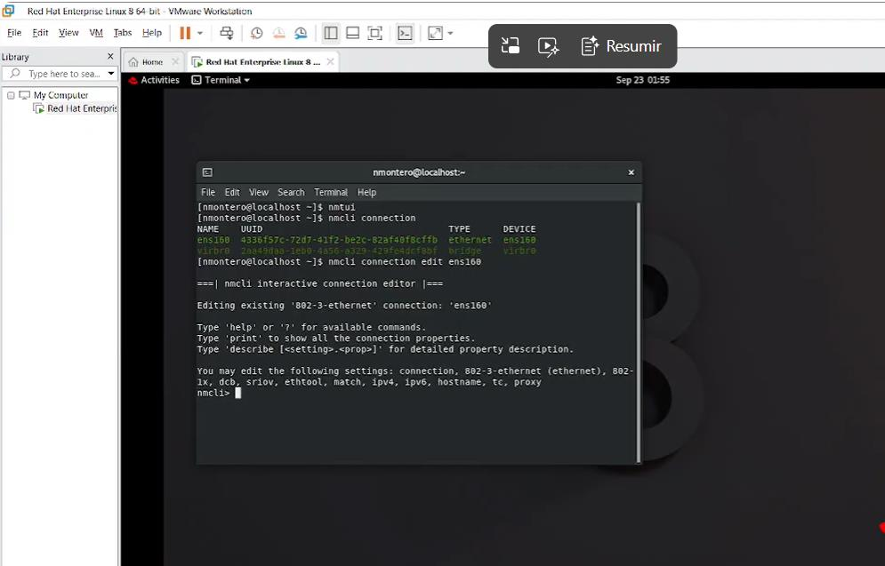


> [!TIP]
> `nmtui` (mencionado al inicio de la captura) es la alternativa con interfaz de texto a `nmcli`: ofrece menús navegables con el teclado para la misma tarea. `nmcli` es más preciso para *scripting* y automatización; `nmtui` resulta más cómodo para configurar de forma interactiva sin memorizar comandos.

**3.** Dentro del editor, consultamos la configuración IPv4 actual con `print`:

```nmcli
print ipv4.method
```

Antes de cualquier cambio, `ipv4.method` está en `auto` (DHCP) y el resto de los parámetros IPv4 (DNS, direcciones, gateway, rutas) están vacíos, ya que se obtienen automáticamente del servidor DHCP.

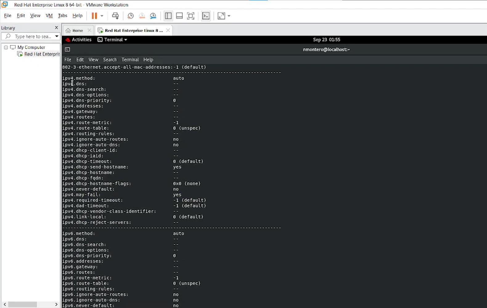


---

## Parte B: Cambiar a direccionamiento manual

**1.** Cambiamos el método de configuración de `auto` a `manual`:

```nmcli
set ipv4.method manual
```

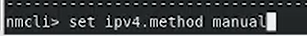


**2.** Confirmamos el cambio:

```nmcli
print ipv4.method
```

```text
ipv4.method: manual
```

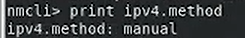


> [!IMPORTANT]
> Cambiar a `manual` **no aplica ningún cambio de inmediato**: solo modifica los parámetros en el editor interactivo de `nmcli`, en memoria. Los cambios se guardan y se aplican hasta ejecutar `save` y `activate` (Parte F). Mientras tanto, se pueden seguir ajustando el resto de los parámetros con tranquilidad.

---

## Parte C: Asignar la dirección IP

**1.** Asignamos la dirección IP con su máscara de red en formato CIDR:

```nmcli
set ipv4.addresses 192.168.0.16/24
```

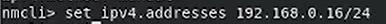


**2.** La dirección queda reflejada junto al resto de la configuración:

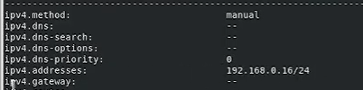


---

## Parte D: Configurar la puerta de enlace

**1.** Asignamos la puerta de enlace (*gateway*) por la que saldrá el tráfico hacia otras redes:

```nmcli
set ipv4.gateway 192.168.0.1
```

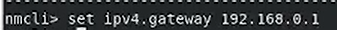


---

## Parte E: Configurar los servidores DNS

**1.** Asignamos los servidores DNS, separados por comas. En este caso, los servidores públicos de Google:

```nmcli
set ipv4.dns 8.8.8.8, 8.8.4.4
```

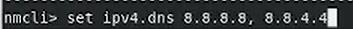


**2.** Con `print`, revisamos el resumen completo de la configuración IPv4 antes de guardar: método manual, los dos servidores DNS, la dirección y la puerta de enlace, todos ya establecidos.

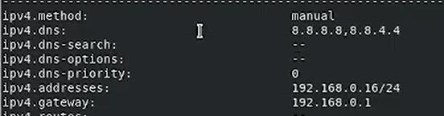


---

## Parte F: Guardar y activar los cambios

**1.** Guardamos la configuración:

```nmcli
save
```

**2.** Activamos la conexión para que los cambios tomen efecto:

```nmcli
activate
```

La salida confirma que la conexión `ens160` se actualizó correctamente y que la activación se está monitoreando a través de D-Bus.

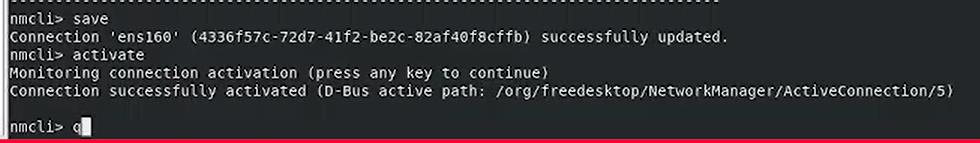


**3.** Salimos del editor interactivo (`quit`) y verificamos, ya desde una terminal normal, que la nueva dirección IP se aplicó:

```bash
ip addr
```

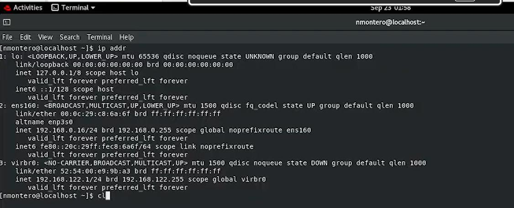


La interfaz `ens160` muestra la dirección `192.168.0.16/24` configurada de forma estática, en lugar de la que asignaba el servidor DHCP.

---

## Referencia de comandos

| Comando | Función |
|---|---|
| `nmcli connection` | Lista las conexiones de red configuradas |
| `nmcli connection edit <conexión>` | Abre el editor interactivo de una conexión |
| `print <propiedad>` | Muestra el valor actual de una propiedad (dentro del editor) |
| `set <propiedad> <valor>` | Cambia el valor de una propiedad (dentro del editor) |
| `save` | Guarda los cambios realizados en el editor |
| `activate` | Aplica (activa) la configuración guardada |
| `quit` | Sale del editor interactivo |
| `ip addr` | Muestra las interfaces de red y sus direcciones IP actuales |
| `nmtui` | Alternativa con interfaz de texto para configurar la red |

---

## Demostración en video

Esta práctica cuenta con una demostración en video donde se muestra el proceso completo del laboratorio. Las capturas del procedimiento se encuentran en la carpeta `images/`.

**Video de la práctica:** [Ver demostración en YouTube](https://www.youtube.com/watch?v=9R5Tt0qDLMA&list=PLIJEt4hLYnOVlwzFyi3vGdJAej-IfKZvR&index=3)

---

## Solución de problemas frecuentes

| Problema | Causa probable | Solución |
|---|---|---|
| Los cambios de `set` no parecen aplicarse | Falta ejecutar `save` y `activate` | Los cambios quedan en memoria hasta guardarlos y activarlos; verificar con `print` antes de salir |
| La interfaz pierde conectividad tras `activate` | La dirección, la máscara o el gateway no corresponden a la red real | Revisar que los tres valores sean coherentes entre sí y con la red física o virtual utilizada |
| `ip addr` sigue mostrando la IP anterior | No se guardó o no se activó la conexión, o la interfaz necesita reiniciarse | Repetir `save` y `activate` desde el editor, o ejecutar `nmcli connection up ens160` |
| No se puede resolver nombres de dominio tras el cambio | Los servidores DNS no se configuraron o no son alcanzables | Verificar `ipv4.dns` con `print` y comprobar la conectividad hacia los servidores DNS asignados |

---

[← Volver al laboratorio](../README.md)
