[← Volver al laboratorio](../README.md)

# 04 · Control de disco duro y formato de particiones


Gestión de almacenamiento en RHEL de principio a fin: se agrega un disco virtual nuevo a la máquina virtual, se crea una partición con `fdisk`, se formatea con el sistema de archivos `ext4`, y se monta en distintos puntos del sistema de archivos.


## Objetivo

Agregar un segundo disco a la máquina virtual, crear una partición dentro de él, darle un sistema de archivos y verificar que los datos que contiene persisten sin importar en qué directorio se monte.

## Entorno

| Elemento | Valor |
|---|---|
| Hipervisor | VMware Workstation |
| Distribución | RHEL (Red Hat Enterprise Linux) |
| Disco existente | `nvme0n1`, 35 GB (contiene `/boot` y un volumen LVM con `/` y `[SWAP]`) |
| Disco nuevo | `nvme0n2`, 20 GB, tipo NVMe |
| Partición creada | `nvme0n2p1`, 4.8 GiB, tipo Linux, formateada en `ext4` |

## Índice

- [Parte A: Agregar un disco virtual](#parte-a-agregar-un-disco-virtual)
- [Parte B: Crear la partición con fdisk](#parte-b-crear-la-partición-con-fdisk)
- [Parte C: Formatear la partición](#parte-c-formatear-la-partición)
- [Parte D: Montar, verificar y remontar](#parte-d-montar-verificar-y-remontar)
- [Referencia de comandos](#referencia-de-comandos)
- [Solución de problemas frecuentes](#solución-de-problemas-frecuentes)

---

## Parte A: Agregar un disco virtual

**1.** Con la máquina virtual apagada, entramos a **Virtual Machine Settings** y hacemos clic en **Add** para agregar hardware nuevo. Antes de agregarlo, el único disco presente es de 35 GB.

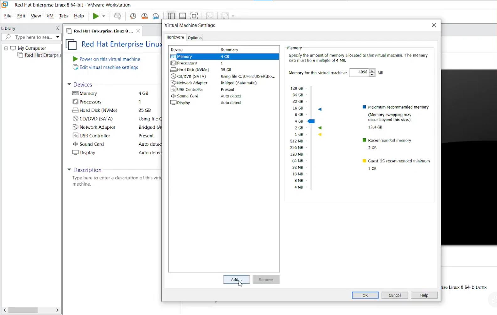


**2.** En el **Add Hardware Wizard**, seleccionamos **Hard Disk**.

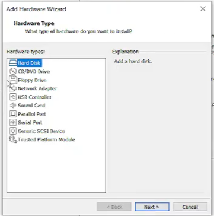


**3.** Elegimos el tipo de disco **NVMe** (la opción recomendada).

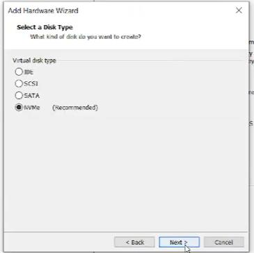


**4.** Seleccionamos **Create a new virtual disk**.

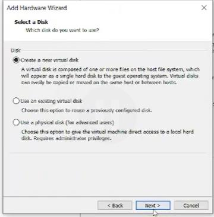


**5.** Especificamos la capacidad: **20 GB**, sin reservar todo el espacio de inmediato (*Allocate all disk space now* sin marcar), y dividido en múltiples archivos.

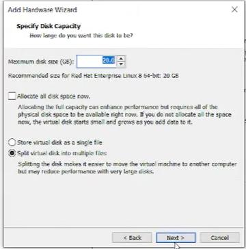


> [!TIP]
> Dividir el disco en múltiples archivos (en vez de uno solo) facilita mover la máquina virtual entre equipos y reduce el riesgo de perder todo el disco si uno de los archivos se corrompe, aunque puede afectar levemente el rendimiento con discos muy grandes.

**6.** Asignamos un nombre al archivo del disco y confirmamos con **Finish**.

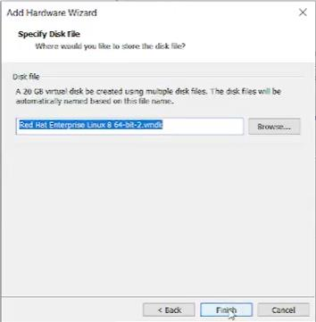


---

## Parte B: Crear la partición con fdisk

**1.** Encendemos la máquina virtual y revisamos los discos con `lsblk`. El nuevo disco (`nvme0n2`, 20 GB) aparece sin particiones, junto al disco original (`nvme0n1`) con su partición de arranque y su volumen LVM.

```bash
lsblk
```

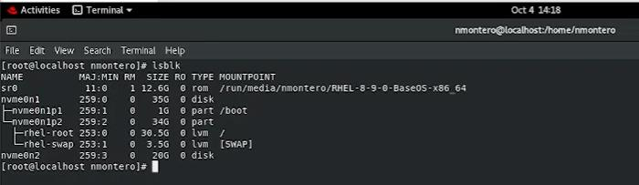


**2.** Abrimos el disco nuevo con `fdisk`:

```bash
fdisk /dev/nvme0n2
```

Como el disco está vacío, `fdisk` crea una nueva tabla de particiones DOS en memoria (los cambios no se escriben en el disco hasta confirmarlos explícitamente).

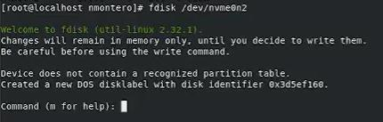


**3.** Dentro de `fdisk`, el comando `m` muestra el menú de ayuda con todas las opciones disponibles (crear, eliminar, listar particiones, cambiar el tipo de tabla, escribir los cambios, etc.).

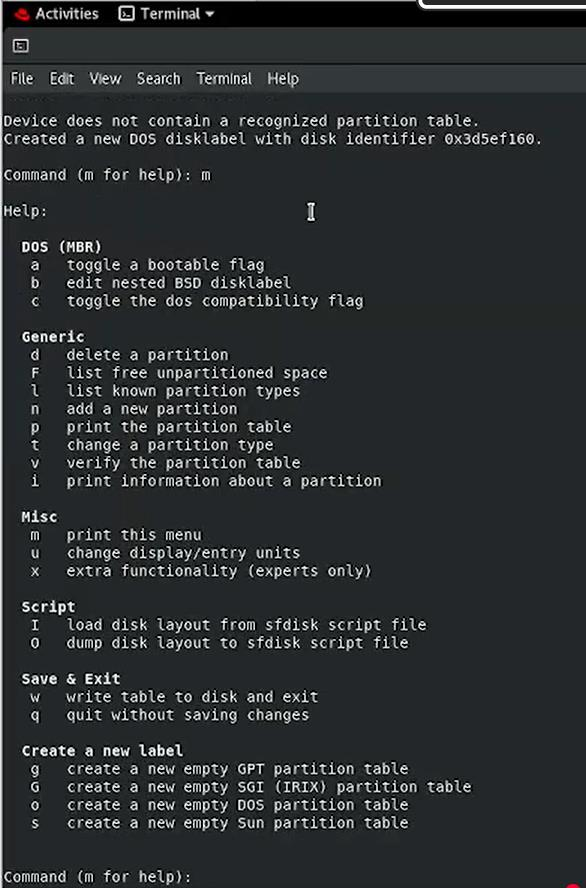


**4.** Creamos una nueva partición con `n`:

- **Partition type:** `p` (primaria)
- **Partition number:** `1` (por defecto)
- **First sector:** el valor por defecto (`2048`)
- **Last sector:** `10000000` (en vez del valor por defecto, que habría usado el disco completo)

```text
Created a new partition 1 of type 'Linux' and of size 4.8 GiB.
```

Con `w`, escribimos la tabla de particiones en el disco:

```text
The partition table has been altered.
Calling ioctl() to re-read partition table.
Syncing disks.
```

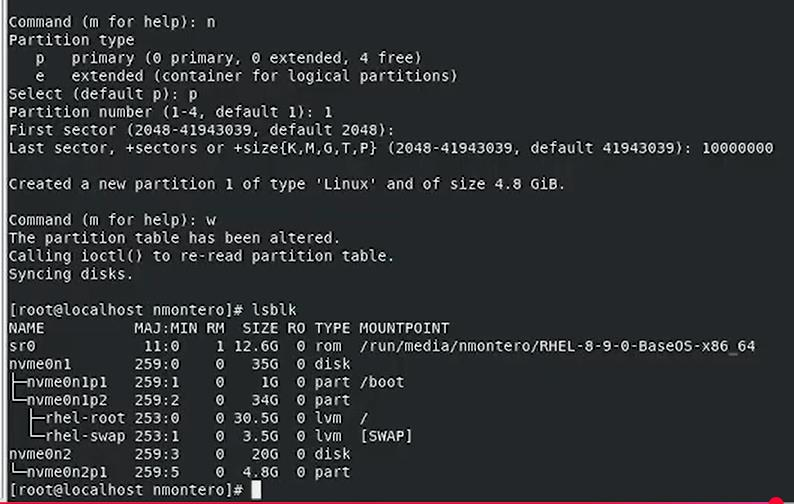


Al volver a ejecutar `lsblk`, aparece la nueva partición `nvme0n2p1`, de 4.8 GiB.

> [!NOTE]
> El disco virtual se creó con 20 GB, pero al especificar manualmente el último sector (`10000000` en vez del máximo disponible), la partición resultante ocupa solo 4.8 GiB. El resto del disco queda sin particionar, disponible para usarse más adelante (por ejemplo, para una segunda partición).

---

## Parte C: Formatear la partición

**1.** Nos ubicamos en el directorio de trabajo y creamos una carpeta que servirá como punto de montaje:

```bash
pwd
cd Desktop
mkdir neury
```

**2.** Formateamos la partición nueva con el sistema de archivos **ext4**:

```bash
mkfs.ext4 /dev/nvme0n2p1
```

`mkfs.ext4` crea la estructura del sistema de archivos: calcula los bloques e inodos, genera un UUID único para el sistema de archivos, reserva copias de respaldo del superbloque, y escribe las tablas de inodos, el *journal* y los superbloques.

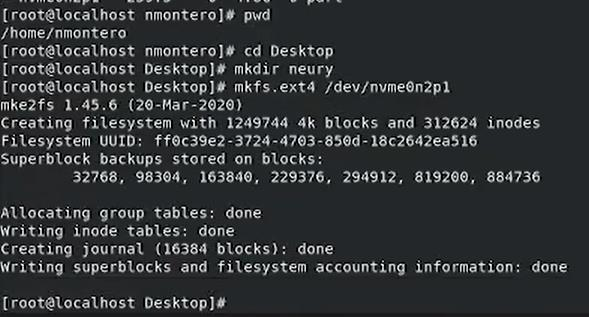


---

## Parte D: Montar, verificar y remontar

**1.** Montamos la partición en la carpeta creada anteriormente:

```bash
mount /dev/nvme0n2p1 /home/nmontero/Desktop/neury
```

**2.** Entramos a esa carpeta y creamos un archivo de prueba:

```bash
cd neury
touch AdrianAlcantara.txt
```

**3.** Volvemos al directorio anterior y desmontamos la partición:

```bash
cd ..
umount /dev/nvme0n2p1
```

**4.** Montamos la **misma** partición, pero esta vez en `/mnt` (un punto de montaje temporal estándar en Linux):

```bash
mount /dev/nvme0n2p1 /mnt
cd /mnt
ls
```

```text
AdrianAlcantara.txt  lost+found
```

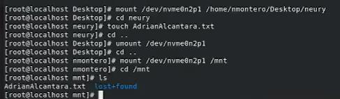


El archivo `AdrianAlcantara.txt` sigue presente, aunque se montó la partición en un directorio distinto al que se usó para crearlo.

> [!NOTE]
> Esto demuestra un punto clave sobre el montaje en Linux: los datos **pertenecen a la partición**, no al directorio donde se monta. El punto de montaje es solo la "puerta de entrada" a ese contenido; se puede cambiar sin perder ni modificar los datos. `lost+found` es un directorio reservado que crea automáticamente `mkfs.ext4` para que `fsck` guarde ahí los archivos recuperados en caso de encontrar daños en el sistema de archivos.

---

## Referencia de comandos

| Comando | Función |
|---|---|
| `lsblk` | Lista los discos y particiones del sistema, con su tamaño y punto de montaje |
| `fdisk /dev/<disco>` | Abre el editor de particiones interactivo de un disco |
| `n` (dentro de `fdisk`) | Crea una nueva partición |
| `w` (dentro de `fdisk`) | Escribe los cambios en la tabla de particiones y sale |
| `m` (dentro de `fdisk`) | Muestra el menú de ayuda con todos los comandos disponibles |
| `mkfs.ext4 /dev/<partición>` | Formatea una partición con el sistema de archivos ext4 |
| `mount /dev/<partición> <directorio>` | Monta una partición en un directorio |
| `umount /dev/<partición>` | Desmonta una partición |

---

## Solución de problemas frecuentes

| Problema | Causa probable | Solución |
|---|---|---|
| El disco nuevo no aparece en `lsblk` | La máquina virtual se encendió antes de agregar el disco, o sigue apagada | Apagar la VM, agregar el disco desde **Virtual Machine Settings**, y encenderla de nuevo |
| `fdisk` no encuentra el disco indicado | El nombre del dispositivo es incorrecto | Verificar el nombre exacto con `lsblk` antes de ejecutar `fdisk` |
| Los cambios de `fdisk` no se aplican | Se salió sin ejecutar `w` | Los cambios en `fdisk` quedan solo en memoria hasta confirmarlos con `w`; usar `q` para salir sin guardar si fue un error |
| `mount` indica que el punto de montaje no existe | La carpeta de destino no se creó antes de montar | Crear el directorio con `mkdir` antes de ejecutar `mount` |
| `umount` indica que el dispositivo está ocupado (*busy*) | Hay una terminal o proceso con el directorio como ubicación actual | Salir del directorio (`cd ..`) antes de desmontar, o cerrar los procesos que lo estén usando |

---

[← Volver al laboratorio](../README.md)
