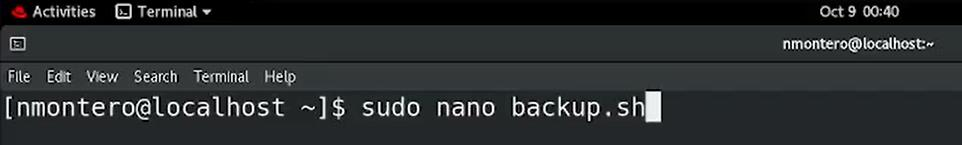
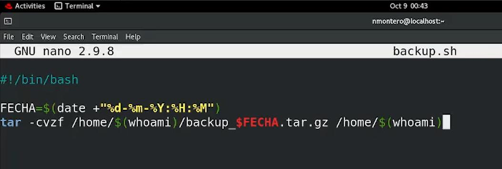
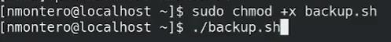
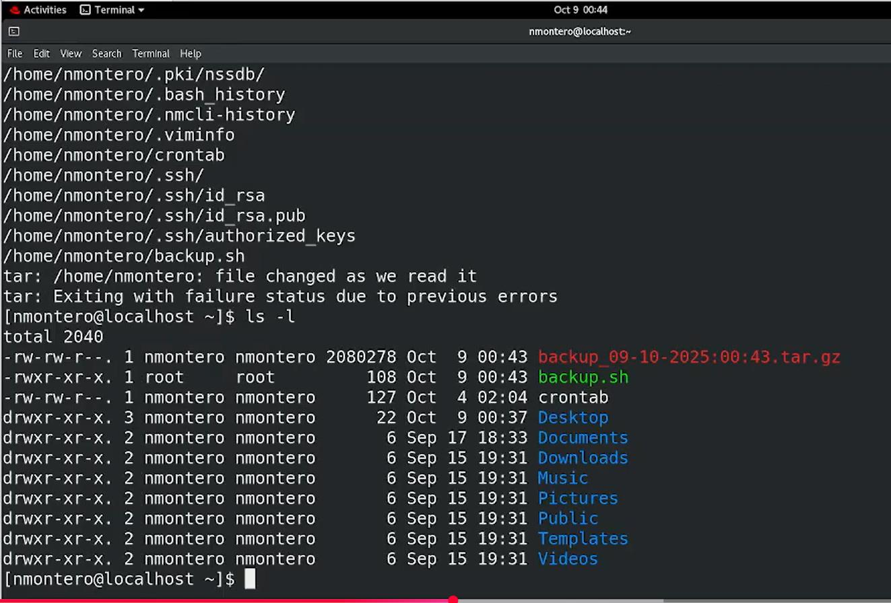
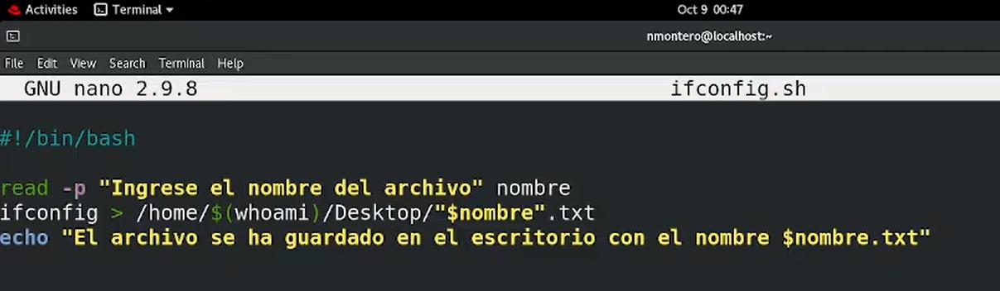
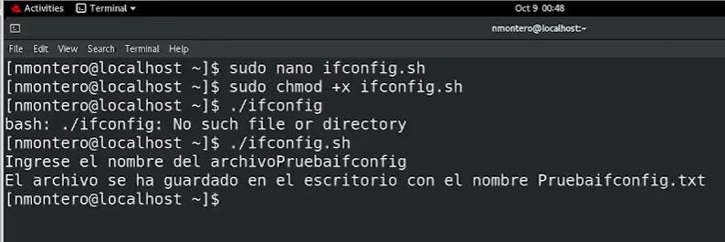
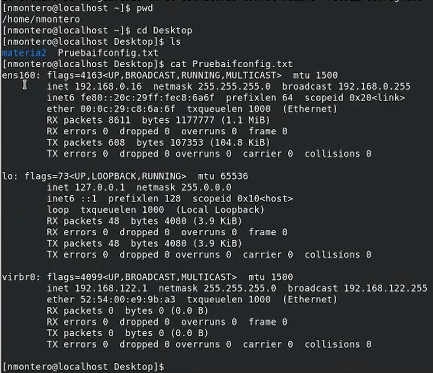

[← Volver al laboratorio](../README.md)

# 05 · Scripting en Bash: respaldo automático y captura de red


Dos scripts de Bash que automatizan tareas de administración habituales: uno genera un respaldo comprimido del directorio personal con la fecha en el nombre del archivo, y el otro guarda la configuración de red en un archivo de texto con un nombre elegido por el usuario.


## Entorno

| Elemento | Valor |
|---|---|
| Distribución | RHEL (Red Hat Enterprise Linux) |
| Intérprete | Bash |
| Scripts | `backup.sh`, `ifconfig.sh` |

## Índice

- [Parte A: backup.sh — respaldo con fecha automática](#parte-a-backupsh--respaldo-con-fecha-automática)
- [Parte B: ifconfig.sh — captura de la configuración de red](#parte-b-ifconfigsh--captura-de-la-configuración-de-red)
- [Referencia de comandos](#referencia-de-comandos)
- [Solución de problemas frecuentes](#solución-de-problemas-frecuentes)

---

## Parte A: backup.sh — respaldo con fecha automática

**1.** Creamos el script:

```bash
sudo nano backup.sh
```




**2.** Contenido del script:

```bash
#!/bin/bash

FECHA=$(date +"%d-%m-%Y:%H:%M")
tar -cvzf /home/$(whoami)/backup_$FECHA.tar.gz /home/$(whoami)
```




`FECHA` guarda la fecha y hora actuales en el formato día-mes-año:hora:minuto. `tar -cvzf` crea (`c`) un archivo comprimido con gzip (`z`), mostrando el progreso (`v`), en el archivo (`f`) indicado: un respaldo del directorio personal del usuario, cuyo nombre incluye esa fecha para no sobrescribir respaldos anteriores.

**3.** Le damos permisos de ejecución y lo ejecutamos:

```bash
chmod +x backup.sh
./backup.sh
```




**4.** `tar` muestra cada archivo que va agregando al respaldo. Al terminar, aparece una advertencia y el comando termina con estado de error:

```text
tar: /home/nmontero: file changed as we read it
tar: Exiting with failure status due to previous errors
```

Verificamos el resultado con `ls -l`:




El archivo `backup_09-10-2025:00:43.tar.gz` se creó correctamente (2 080 278 bytes), junto al resto del contenido del directorio personal.

> [!NOTE]
> El aviso *"file changed as we read it"* es una advertencia habitual de `tar`, no necesariamente un fallo grave: ocurre porque el directorio que se está respaldando (`/home/nmontero`) sigue "vivo" mientras se lee (por ejemplo, por archivos temporales de la propia sesión, como `.bash_history`, que se actualizan mientras `tar` los procesa). El respaldo igual se genera, aunque el comando reporte un código de salida distinto de cero. En un script que se vaya a programar de forma desatendida (por ejemplo, con `cron`), conviene revisar el código de salida con cuidado y no asumir automáticamente que un valor distinto de cero significa que el respaldo está vacío o corrupto.

> [!TIP]
> El formato de fecha usado (`%H:%M`, con dos puntos) genera nombres de archivo válidos en Linux, pero los dos puntos (`:`) no están permitidos en nombres de archivo de Windows. Si el respaldo se fuera a copiar a un sistema Windows, convendría usar un separador distinto, como un guion (`%d-%m-%Y_%H-%M`).

---

## Parte B: ifconfig.sh — captura de la configuración de red

**1.** Contenido del script:

```bash
#!/bin/bash

read -p "Ingrese el nombre del archivo" nombre
ifconfig > /home/$(whoami)/Desktop/"$nombre".txt
echo "El archivo se ha guardado en el escritorio con el nombre $nombre.txt"
```




`read -p` muestra un mensaje y guarda lo que escriba el usuario en la variable `nombre`. La salida de `ifconfig` se redirige (`>`) hacia un archivo de texto en el escritorio, con el nombre indicado. Al final, `echo` confirma dónde quedó guardado.

**2.** Le damos permisos de ejecución y lo ejecutamos:

```bash
chmod +x ifconfig.sh
./ifconfig
```

```text
bash: ./ifconfig: No such file or directory
```

El primer intento falla porque el nombre del archivo es `ifconfig.sh`, no `ifconfig`. Lo ejecutamos con el nombre correcto:

```bash
./ifconfig.sh
```

```text
Ingrese el nombre del archivoPruebaifconfig
El archivo se ha guardado en el escritorio con el nombre Pruebaifconfig.txt
```




**3.** Verificamos el resultado en el escritorio:

```bash
cd Desktop
ls
cat Pruebaifconfig.txt
```




El archivo contiene la salida completa de `ifconfig`: las interfaces de red del equipo (`ens160`, `lo`, `virbr0`) con sus direcciones IP, máscaras y estadísticas de tráfico.

> [!TIP]
> En el `read -p` del script falta un espacio al final del mensaje (`"Ingrese el nombre del archivo"`, sin `: ` ni espacio), por lo que lo que escribe el usuario queda pegado al texto (`...archivoPruebaifconfig`). Es un detalle únicamente visual: agregar `"Ingrese el nombre del archivo: "` haría la salida más legible, sin cambiar el funcionamiento del script.

---

## Referencia de comandos

| Comando / sintaxis | Función |
|---|---|
| `#!/bin/bash` | *Shebang*: indica con qué intérprete debe ejecutarse el script |
| `$(comando)` | Sustitución de comandos: ejecuta `comando` y reemplaza la expresión con su salida |
| `date +"<formato>"` | Muestra la fecha/hora actual en el formato indicado |
| `tar -cvzf <archivo.tar.gz> <ruta>` | Crea un archivo comprimido con gzip a partir de una ruta |
| `read -p "<mensaje>" <variable>` | Muestra un mensaje y guarda lo escrito por el usuario en una variable |
| `comando > archivo` | Redirige la salida de un comando hacia un archivo (lo sobrescribe si ya existe) |
| `chmod +x <script>` | Da permisos de ejecución a un script |
| `./<script>` | Ejecuta un script desde el directorio actual |

---

## Solución de problemas frecuentes

| Problema | Causa probable | Solución |
|---|---|---|
| `bash: ./script: No such file or directory` al ejecutarlo | El nombre usado no incluye la extensión real del archivo | Verificar el nombre exacto con `ls` antes de ejecutarlo |
| `tar` termina con "Exiting with failure status" | El directorio respaldado cambió mientras se leía (archivos temporales de la sesión activa) | Revisar que el archivo `.tar.gz` se haya creado igualmente con `ls -l`; en scripts automatizados, no asumir fallo solo por el código de salida |
| El script no tiene permiso para ejecutarse (`Permission denied`) | Falta `chmod +x` | Ejecutar `chmod +x <script>` antes de `./<script>` |
| El texto que escribe el usuario queda pegado al mensaje de `read -p` | Falta un espacio o `:` al final del mensaje | Agregar un espacio o dos puntos al final del texto entre comillas |
| El archivo generado no aparece donde se esperaba | La ruta de destino en el script usa una variable (`$(whoami)`) que no coincide con el usuario actual | Verificar con `whoami` qué usuario ejecuta el script, ya que la ruta depende de esa variable |

---

[← Volver al laboratorio](../README.md)
