[← Volver al laboratorio](../README.md)

# 06 · Servidor de correo SMTP con Postfix


Instalación y configuración de **Postfix** como agente de transporte de correo (MTA) en RHEL, configurado para reenviar (*relay*) el correo saliente a través del servidor SMTP de Gmail mediante una contraseña de aplicación.

> [!NOTE]
> Al igual que otras prácticas de este repositorio, esta no tuvo un How-To escrito por separado: se documentó únicamente con capturas de la terminal, tomadas como evidencia del procedimiento.

> [!WARNING]
> **Credenciales redactadas.** Las capturas originales de esta práctica mostraban, en texto plano, una contraseña de aplicación real de Gmail junto con las direcciones de correo asociadas. Esa información se **cubrió** antes de publicar las imágenes aquí. Si usas una cuenta real para una práctica similar, revoca la contraseña de aplicación una vez termines (o antes de compartir cualquier captura), desde la configuración de seguridad de tu cuenta de Google, y genera una nueva si necesitas seguir usando el relay.

## Objetivo

Configurar Postfix para que el servidor RHEL pueda enviar correo saliente, usando la cuenta SMTP de Gmail como *relay* autenticado y cifrado.

## Entorno

| Elemento | Valor |
|---|---|
| Distribución | RHEL (Red Hat Enterprise Linux) |
| MTA | Postfix |
| Dominio configurado | `neury.rod.com` |
| Relay SMTP | `smtp.gmail.com:587`, con STARTTLS y autenticación SASL |

## Índice

- [Parte A: Instalar Postfix](#parte-a-instalar-postfix)
- [Parte B: Identidad del servidor de correo](#parte-b-identidad-del-servidor-de-correo)
- [Parte C: Configurar el relay hacia Gmail](#parte-c-configurar-el-relay-hacia-gmail)
- [Parte D: Autenticación SASL con una contraseña de aplicación](#parte-d-autenticación-sasl-con-una-contraseña-de-aplicación)
- [Parte E: Enviar un correo de prueba](#parte-e-enviar-un-correo-de-prueba)
- [Referencia de comandos](#referencia-de-comandos)
- [Solución de problemas frecuentes](#solución-de-problemas-frecuentes)

---

## Parte A: Instalar Postfix

**1.** Instalamos el metapaquete de correo (que incluye Postfix como MTA):

```bash
dnf install mail* -y
```

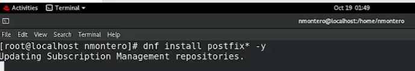

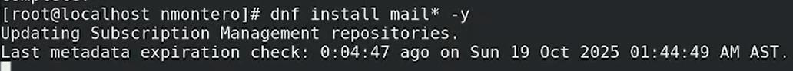


**2.** Nos ubicamos en el directorio de configuración de Postfix y abrimos su archivo principal:

```bash
cd /etc/postfix
ls
vi main.cf
```

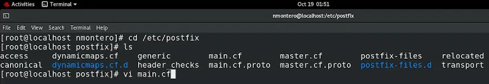


El archivo trae, por defecto, una extensa sección de comentarios explicativos sobre cada parámetro.

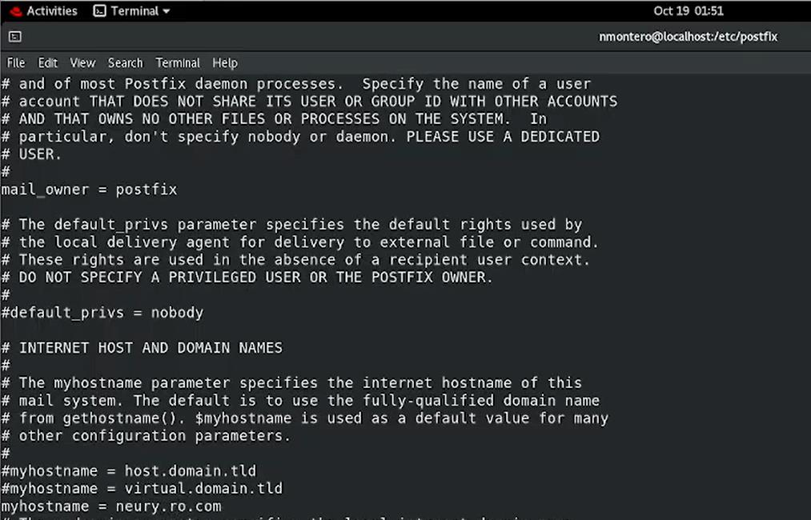


---

## Parte B: Identidad del servidor de correo

**1.** Definimos el dominio del servidor de correo:

```text
mydomain = neury.rod.com
```

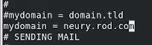


**2.** Definimos el origen del correo saliente, usando el dominio recién configurado:

```text
myorigin = $mydomain
```

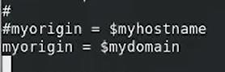


**3.** Definimos qué redes se consideran "de confianza" (`mynetworks`), es decir, desde cuáles se acepta retransmitir correo sin restricciones adicionales: la red local del servidor y la interfaz de loopback.

```text
mynetworks = 192.168.0.16/24, 127.0.0.0/8
```

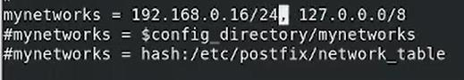


---

## Parte C: Configurar el relay hacia Gmail

**1.** Definimos el servidor que recibirá el correo saliente para reenviarlo: el SMTP de Gmail, en su puerto de envío con STARTTLS.

```text
relayhost = [smtp.gmail.com]:587
```

![relayhost = [smtp.gmail.com]:587](images/c01-relayhost-gmail.jpg)


**2.** Habilitamos TLS para la conexión saliente y la autenticación SASL (necesaria para que Gmail acepte el correo):

```text
smtp_use_tls = yes
smtp_sasl_auth_enable = yes
smtp_tls_security_level = encrypt
smtp_sasl_security_options =
smtp_sasl_password_maps = hash:/etc/postfix/sasl_passwd
```

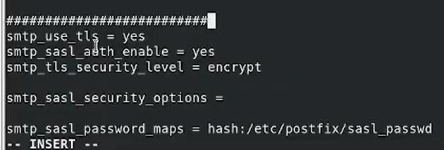


> [!NOTE]
> Dejar `smtp_sasl_security_options` vacío permite cualquier mecanismo de autenticación SASL que ofrezca el servidor remoto (en vez de restringirlo, por ejemplo, excluyendo los mecanismos anónimos con `noanonymous`). Para un servidor expuesto a Internet, conviene revisar esta opción con más detalle; en este laboratorio, el relay es exclusivamente hacia Gmail, un servidor conocido y confiable.

**3.** Indicamos la ruta del paquete de certificados de Autoridades Certificadoras (CA), necesario para validar el certificado TLS de Gmail durante la conexión:

```text
smtp_tls_CAfile = /etc/pki/tls/certs/ca-bundle.crt
```

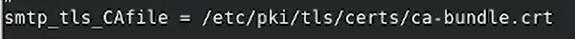


**4.** Revisamos (sin modificar) las rutas de los directorios internos de Postfix:

```text
meta_directory = /etc/postfix
shlib_directory = /usr/lib64/postfix
```

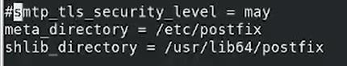


**5.** Guardamos los cambios y salimos del editor:

```vi
:wq!
```

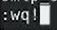


---

## Parte D: Autenticación SASL con una contraseña de aplicación

**1.** Creamos el archivo donde se guardarán las credenciales del relay:

```bash
vi sasl_passwd
```


**2.** Como la cuenta de Gmail usada tiene activada la verificación en dos pasos, no se puede usar su contraseña normal: Google requiere generar una **contraseña de aplicación** específica, desde la configuración de seguridad de la cuenta (*Contraseñas de aplicaciones*).

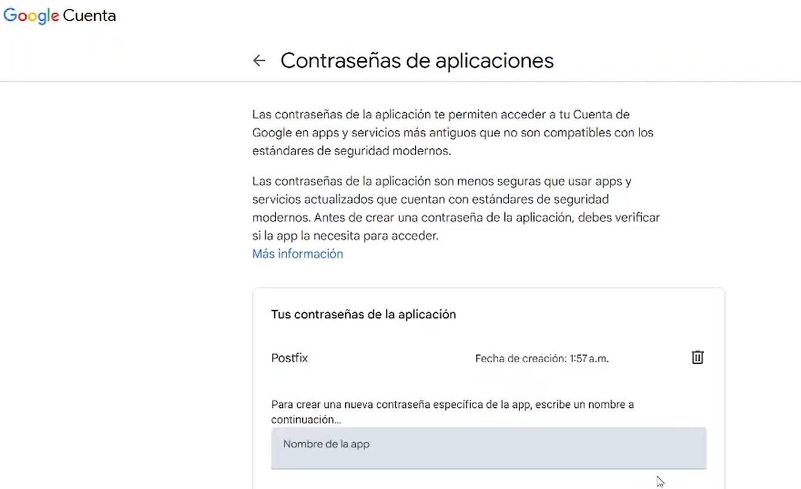


**3.** El archivo `sasl_passwd` asocia el servidor de relay con las credenciales que Postfix usará para autenticarse:

```text
[smtp.gmail.com]:587   <usuario>@gmail.com:<contraseña de aplicación>
```

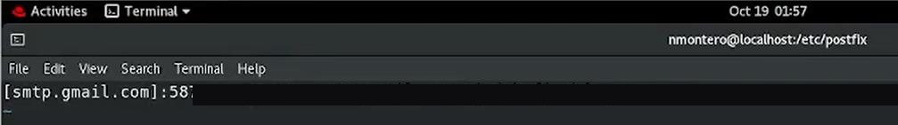


> [!IMPORTANT]
> Este archivo guarda la contraseña **en texto plano**. Por eso, en el siguiente paso se restringen sus permisos para que solo `root` pueda leerlo, y se genera una versión indexada (`.db`) para que Postfix la consulte de forma eficiente sin exponer el archivo de texto directamente en cada envío.

**4.** Generamos la base de datos indexada a partir del archivo de texto, ajustamos sus permisos, y reiniciamos Postfix para aplicar toda la configuración:

```bash
postmap sasl_passwd
chmod 600 sasl_passwd sasl_passwd.db
systemctl start postfix
systemctl restart postfix
```

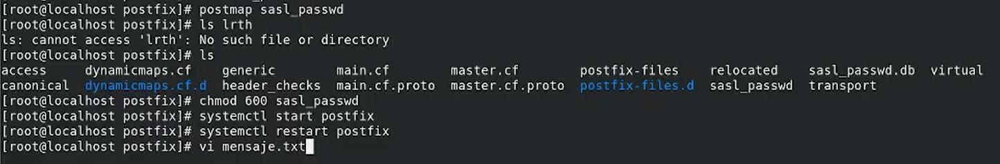


---

## Parte E: Enviar un correo de prueba

**1.** Creamos un archivo de texto con el contenido del mensaje:

```bash
vi mensaje.txt
```

```text
Estudiante: Neury Jorge Montero Mejia
Matricula: 2025-0829
Docente: Adrian Alcantara

Laboratorio 4, Sistemas Operativos 3.
```

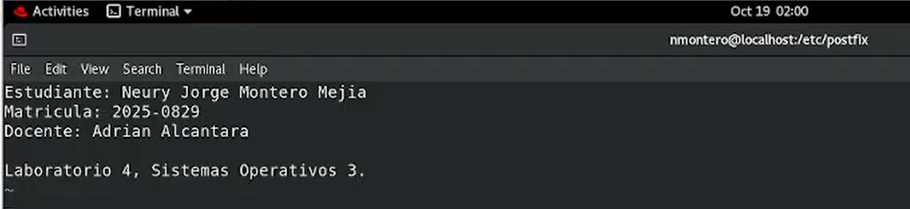


**2.** Enviamos el correo con el comando `mail`, usando el contenido del archivo como cuerpo del mensaje:

```bash
mail -s "Prueba" <destinatario>@gmail.com < mensaje.txt
```


**3.** El correo llega correctamente a la bandeja de entrada, enviado a través del relay de Gmail configurado en Postfix.

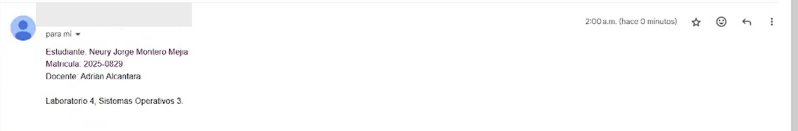


---

## Referencia de comandos

| Comando / archivo | Función |
|---|---|
| `dnf install mail* -y` | Instala el metapaquete de correo, incluido Postfix |
| `/etc/postfix/main.cf` | Archivo principal de configuración de Postfix |
| `mydomain`, `myorigin`, `mynetworks` | Identidad del servidor y redes de confianza |
| `relayhost` | Servidor al que Postfix reenvía el correo saliente |
| `smtp_sasl_password_maps` | Ruta al archivo de credenciales para autenticarse ante el relay |
| `postmap <archivo>` | Genera la base de datos indexada (`.db`) a partir de un archivo de mapeo de Postfix |
| `systemctl restart postfix` | Aplica los cambios de configuración reiniciando el servicio |
| `mail -s "<asunto>" <destinatario> < archivo` | Envía un correo usando el contenido de un archivo como cuerpo |

---

## Solución de problemas frecuentes

| Problema | Causa probable | Solución |
|---|---|---|
| `mail` indica que no se pudo enviar el mensaje (*relay access denied* o similar) | `mynetworks` no incluye la red desde la que se envía, o `relayhost` está mal escrito | Revisar `mynetworks` y la sintaxis de `relayhost` (`[servidor]:puerto`, con corchetes) |
| Gmail rechaza la autenticación | Se usó la contraseña normal de la cuenta en vez de una contraseña de aplicación | Generar una contraseña de aplicación específica desde la configuración de seguridad de Google (requiere verificación en dos pasos activada) |
| Los cambios en `main.cf` no se aplican | Falta reiniciar el servicio | Ejecutar `systemctl restart postfix` después de cada cambio |
| Error de certificado TLS al conectar con el relay | Ruta incorrecta o faltante en `smtp_tls_CAfile` | Verificar que `/etc/pki/tls/certs/ca-bundle.crt` exista y la ruta esté bien escrita |
| El correo se envía pero nunca llega | `sasl_passwd.db` desactualizado respecto a `sasl_passwd` | Volver a ejecutar `postmap sasl_passwd` después de cualquier cambio en el archivo de texto |

---

[← Volver al laboratorio](../README.md)
