[← Volver al laboratorio](../README.md)

# 07 · Endurecimiento de SSH, contraseñas y firewall en RHEL


Práctica de endurecimiento (*hardening*) de un sistema RHEL: restricción del acceso remoto por SSH, política de contraseñas locales, expiración de contraseñas y configuración del firewall.

## Objetivos

| Punto | Descripción |
|:--:|---|
| **A** | Deshabilitar el acceso de `root` por medio de SSH |
| **B** | Configurar un *timeout* de SSH de 5 minutos de inactividad |
| **C** | Exigir contraseñas locales con mínimo 8 caracteres, una mayúscula, una minúscula, un símbolo y un número |
| **D** | Hacer que las contraseñas locales expiren cada 90 días |
| **E** | Configurar el firewall para permitir solo SSH y paquetes ICMP; el resto debe estar bloqueado |

## Entorno

| Elemento | Valor |
|---|---|
| Distribución | RHEL (Red Hat Enterprise Linux), como máquina virtual |
| Equipo host | Windows, usado para conectarse por SSH a la VM |
| IP de la VM | `192.168.0.13` |
| Servicios involucrados | `sshd`, `firewalld` |

## Requisitos previos

- Máquina virtual RHEL con el servicio SSH activo.
- Acceso de `root` (local o por SSH) antes de deshabilitar el acceso remoto de `root`.

## Índice

- [Parte A: Deshabilitar el acceso de root por SSH](#parte-a-deshabilitar-el-acceso-de-root-por-ssh)
- [Parte B: Timeout de SSH por inactividad](#parte-b-timeout-de-ssh-por-inactividad)
- [Parte C: Política de contraseñas locales](#parte-c-política-de-contraseñas-locales)
- [Parte D: Expiración de contraseñas cada 90 días](#parte-d-expiración-de-contraseñas-cada-90-días)
- [Parte E: Firewall: solo SSH e ICMP](#parte-e-firewall-solo-ssh-e-icmp)
- [Referencia de comandos y archivos](#referencia-de-comandos-y-archivos)
- [Lo aprendido](#lo-aprendido)
- [Solución de problemas frecuentes](#solución-de-problemas-frecuentes)

---

## Parte A: Deshabilitar el acceso de root por SSH

**1.** Abrimos el símbolo del sistema en el equipo host (Windows).

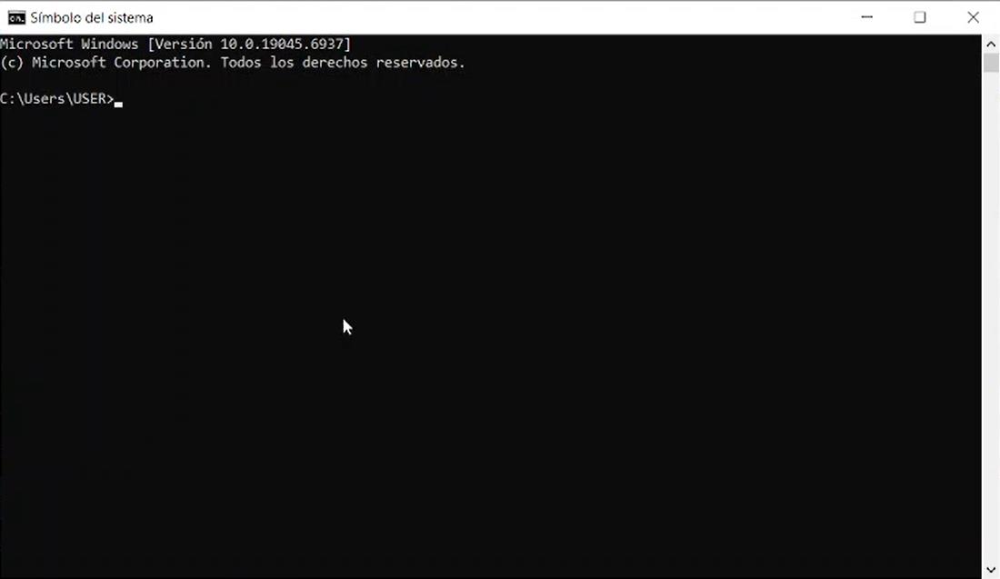


**2.** Nos situamos en la terminal de RHEL y ejecutamos `su` para entrar en modo de superusuario.

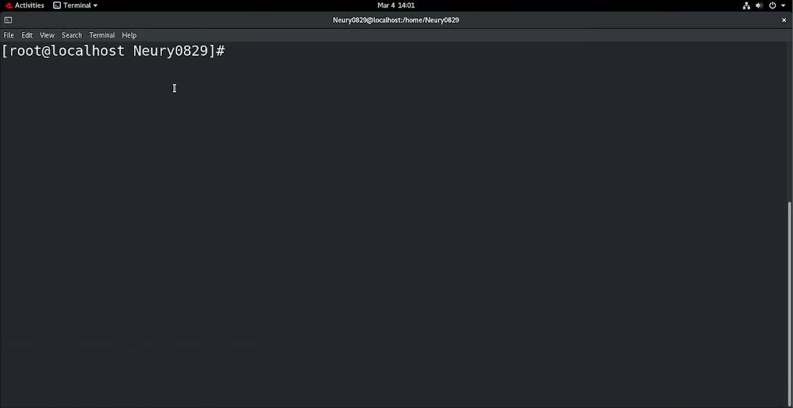


**3.** Ejecutamos `ifconfig` para obtener la dirección IP de la máquina virtual:

```bash
ifconfig
```

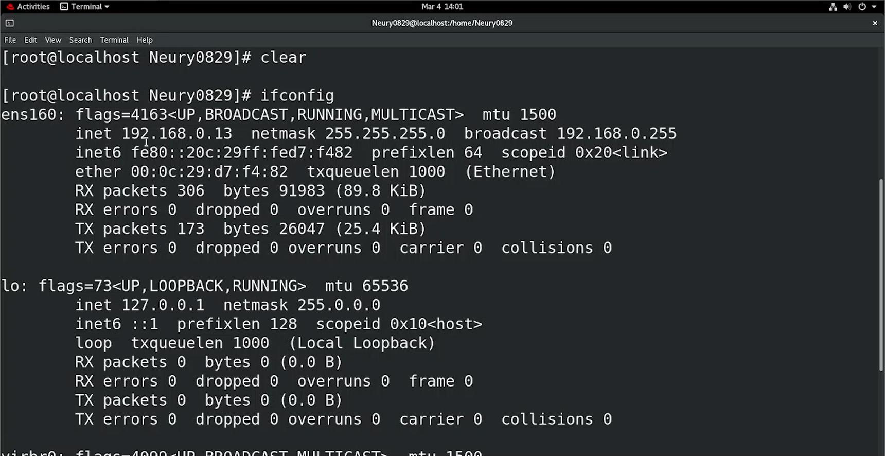


**4.** La IP de la VM es `192.168.0.13`. Desde el equipo host, nos conectamos por SSH:

```bash
ssh root@192.168.0.13
```

Se agrega el *fingerprint* de la máquina a la lista de hosts conocidos (para no tener que confirmarlo en próximas conexiones) y se introduce la contraseña. Esto confirma que la conexión SSH funciona, antes de proceder a restringir el acceso de `root`.

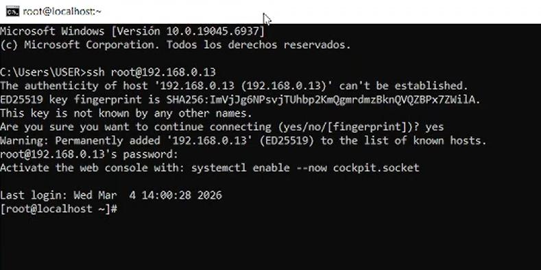


**5.** De forma opcional, verificamos con `whoami` que la sesión remota es efectivamente `root`:

```bash
whoami
```

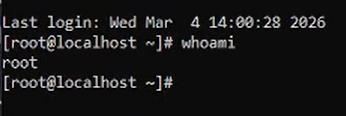


### Deshabilitar el acceso remoto de root

**6.** De vuelta en la máquina virtual, abrimos la configuración global de SSH:

```bash
nano /etc/ssh/sshd_config
```

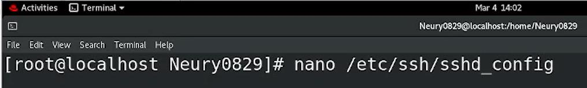


**7.** Buscamos la directiva `PermitRootLogin`.

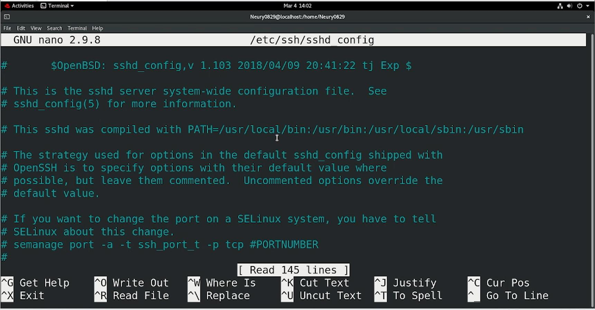


**8.** Como está en `yes` (permite el acceso remoto de `root`), la cambiamos a `no`:

```text
PermitRootLogin no
```

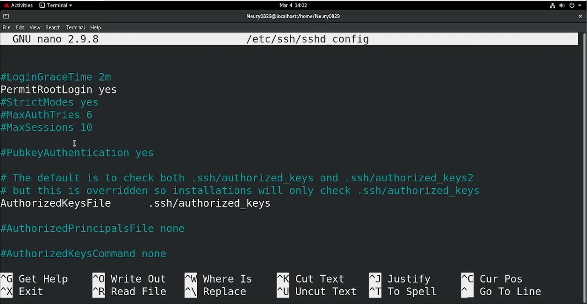


**9.** Guardamos (`Ctrl + O`, `Enter`, `Ctrl + X`) y comprobamos el cambio intentando conectar de nuevo por SSH como `root` desde el equipo host.

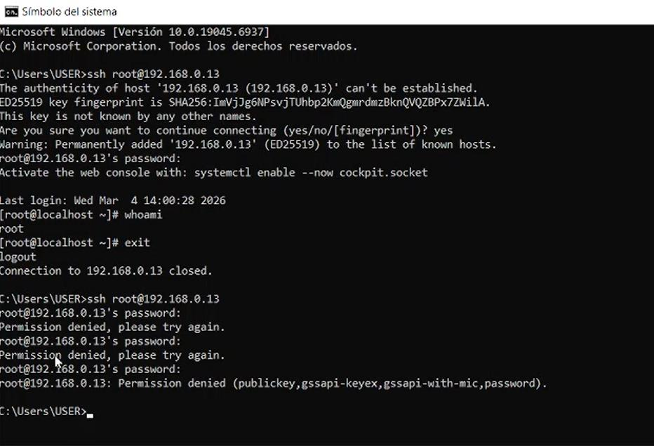


Aunque se ingrese la contraseña correcta, la conexión es rechazada: el acceso remoto de `root` por SSH queda deshabilitado.

> [!IMPORTANT]
> Este cambio aún no se ha aplicado al servicio (eso ocurre en la Parte B, al reiniciar `sshd`). Antes de deshabilitar el acceso de `root`, conviene tener ya configurado un usuario no root con privilegios de `sudo` para seguir administrando el servidor de forma remota.

---

## Parte B: Timeout de SSH por inactividad

**1.** Sin salir de `/etc/ssh/sshd_config`, nos desplazamos hasta las siguientes líneas, comentadas por defecto:

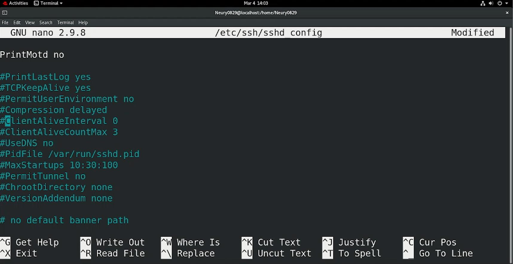


**2.** Las descomentamos y configuramos:

```text
ClientAliveInterval 300
ClientAliveCountMax 0
```

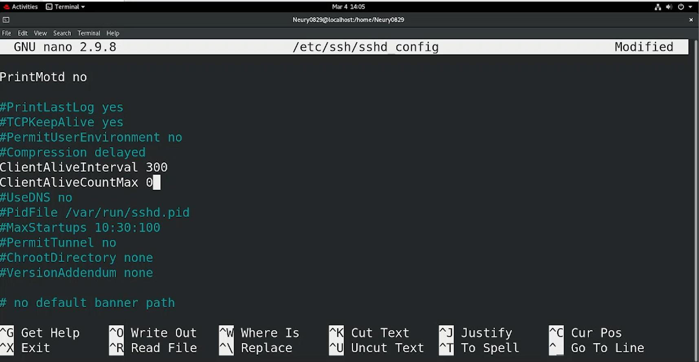


> [!NOTE]
> `ClientAliveInterval` define cada cuántos segundos el servidor envía una señal de verificación al cliente si no ha recibido datos. `ClientAliveCountMax` define cuántas de esas señales pueden quedar sin respuesta antes de cerrar la sesión. Con `ClientAliveCountMax 0`, la sesión se cierra apenas falla la primera verificación, por lo que el *timeout* efectivo es, en la práctica, igual al valor de `ClientAliveInterval`: **300 segundos (5 minutos)** de inactividad.

**3.** Guardamos y salimos (`Ctrl + O`, `Enter`, `Ctrl + X`), y reiniciamos el servicio `sshd` para aplicar **todos** los cambios hechos al archivo (incluido el de la Parte A):

```bash
systemctl restart sshd
```

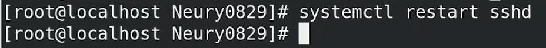


---

## Parte C: Política de contraseñas locales

**1.** Abrimos el archivo de configuración de calidad de contraseñas:

```bash
nano /etc/security/pwquality.conf
```

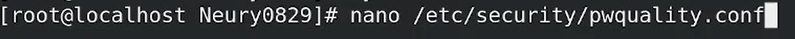


**2.** Descomentamos `minlen` y lo dejamos en `8` (longitud mínima de caracteres):

```text
minlen = 8
```

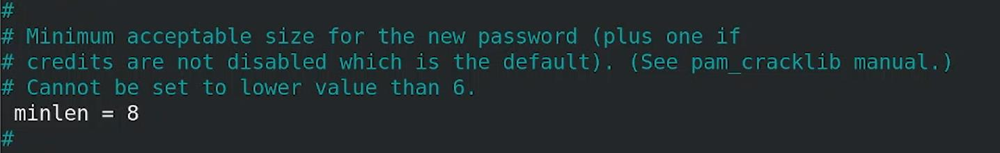


**3.** Descomentamos `ucredit` y lo dejamos en `1` (mínimo una letra mayúscula):

```text
ucredit = 1
```

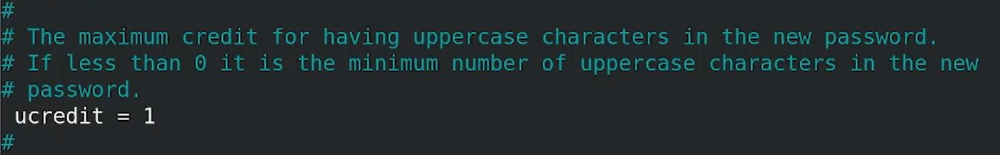


**4.** Descomentamos `lcredit` y lo dejamos en `1` (mínimo una letra minúscula):

```text
lcredit = 1
```

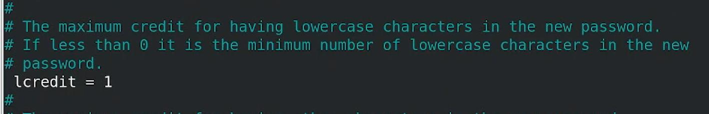


**5.** Descomentamos `ocredit` y lo dejamos en `1` (mínimo un símbolo/carácter especial):

```text
ocredit = 1
```

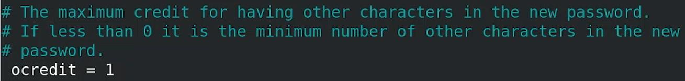


**6.** Descomentamos `minclass` y lo dejamos en `1` (exige una cantidad mínima de clases de caracteres distintas: dígitos, mayúsculas, minúsculas o símbolos):

```text
minclass = 1
```

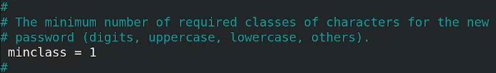


**7.** Guardamos y salimos (`Ctrl + O`, `Enter`, `Ctrl + X`).

> [!NOTE]
> En `pwquality.conf`, los valores de `ucredit`, `lcredit`, `dcredit` y `ocredit` en positivo representan un **crédito máximo** hacia la longitud mínima por cada carácter de esa clase (y en negativo, un **mínimo exigido** de esa clase). Dejarlos en `1` es la forma usada en esta práctica para orientar al usuario a incluir al menos un carácter de cada clase. La combinación de estos cinco parámetros es la que en conjunto produce el requisito completo: mínimo 8 caracteres, con al menos una mayúscula, una minúscula, un símbolo y un número.

---

## Parte D: Expiración de contraseñas cada 90 días

**1.** Abrimos el archivo de configuración de inicios de sesión y contraseñas:

```bash
nano /etc/login.defs
```

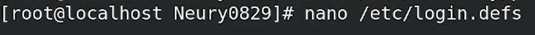


**2.** Nos desplazamos hasta las siguientes configuraciones:

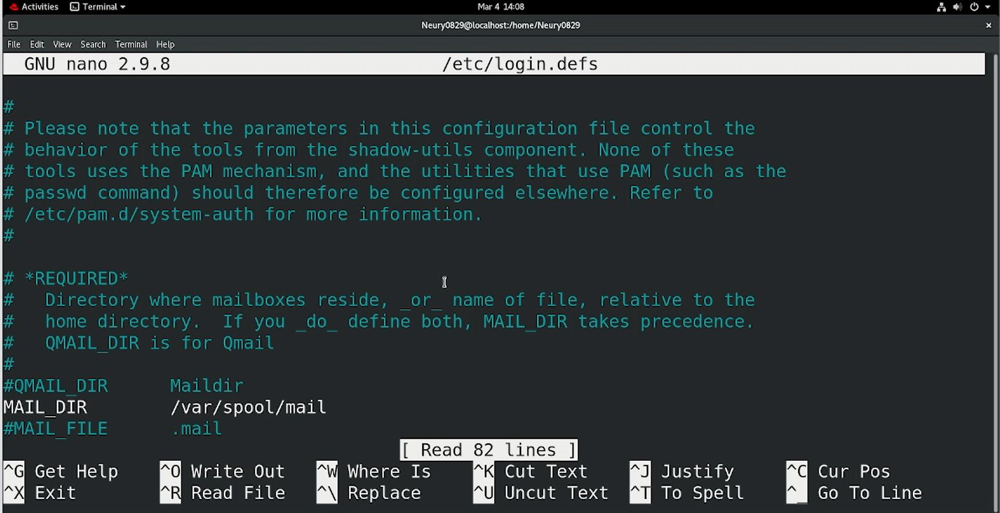

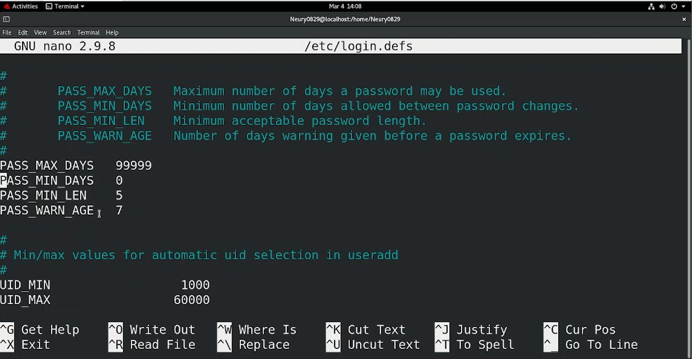


**3.** Cambiamos `PASS_MAX_DAYS` de `99999` (prácticamente sin expiración) a `90`:

```text
PASS_MAX_DAYS   90
```

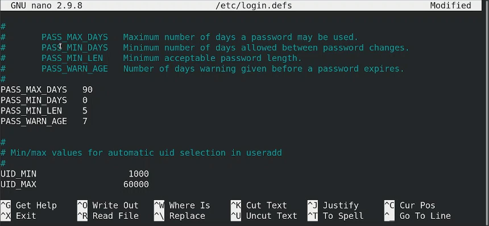


**4.** Guardamos y salimos (`Ctrl + O`, `Enter`, `Ctrl + X`).

> [!NOTE]
> Este cambio en `/etc/login.defs` solo aplica a **los usuarios que se creen después** de modificarlo. Para los usuarios ya existentes, hay que aplicar el cambio individualmente.

**5.** Para un usuario ya existente, la misma configuración se aplica con `chage -M` (días máximos) y se verifica con `chage -l` (lista la información de expiración):

```bash
chage -M 90 nmontero
chage -l nmontero
```

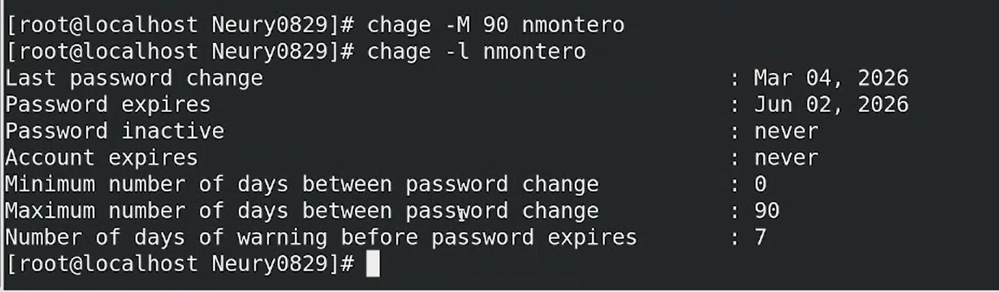


---

## Parte E: Firewall: solo SSH e ICMP

**1.** Primero, listamos los servicios habilitados en la zona activa del firewall:

```bash
firewall-cmd --list-service
```

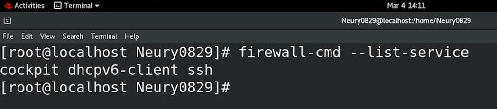


**2.** Agregamos el servicio SSH de forma permanente:

```bash
firewall-cmd --add-service=ssh --permanent
```

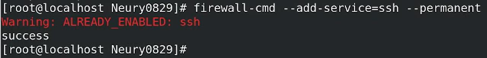


> [!NOTE]
> La advertencia *"ALREADY_ENABLED"* aparece porque el servicio SSH ya estaba habilitado en la zona (como se vio en el paso 1). El comando no causa ningún cambio adicional.

**3.** Para los paquetes ICMP:

```bash
firewall-cmd --add-icmp-block-inversion --permanent
```

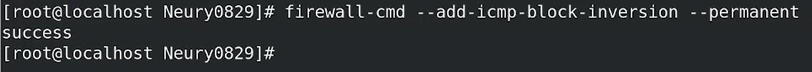


**4.** Guardamos la configuración y la aplicamos reiniciando `firewalld`:

```bash
firewall-cmd --reload
```

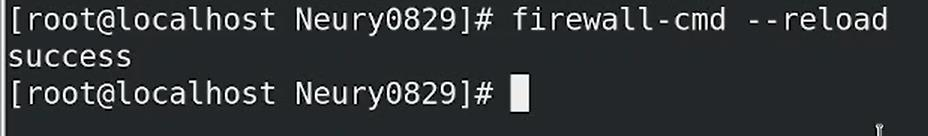


> [!CAUTION]
> **Este comando no produce el resultado buscado.** En `firewalld`, el ICMP se permite **por defecto** (no hay ningún bloqueo de ICMP salvo que se agregue explícitamente a `icmp-blocks`). El parámetro `icmp-block-inversion` **invierte el significado** de esa lista: al activarlo, en vez de ser una lista de tipos de ICMP *bloqueados*, se convierte en una lista de los **únicos** tipos *permitidos*. Como la lista `icmp-blocks` está vacía, activar la inversión aquí **bloquea todo el tráfico ICMP**, justo lo contrario de lo que pide la práctica.
>
> Para permitir **solo** SSH e ICMP, con todo lo demás bloqueado, no hace falta tocar `icmp-block-inversion`: el comportamiento por defecto de la zona de `firewalld` ya bloquea todo el tráfico entrante que no corresponda a un servicio o puerto explícitamente permitido, y el ICMP ya está permitido por defecto. Bastaría con:
>
> ```bash
> firewall-cmd --add-service=ssh --permanent
> firewall-cmd --reload
> firewall-cmd --list-all
> ```
>
> Si en cambio se necesitara restringir el ICMP a solo ciertos tipos (por ejemplo, únicamente `echo-request`), ahí sí tendría sentido usar `icmp-block-inversion` junto con `icmp-block --add-icmp-block=<tipo>` para cada tipo que se quiera **permitir**, ya que con la inversión activa esa lista pasa a ser la lista blanca.

---

## Referencia de comandos y archivos

| Comando / archivo | Función |
|---|---|
| `ifconfig` | Muestra las interfaces de red y sus direcciones IP |
| `ssh usuario@ip` | Inicia una conexión remota por SSH |
| `/etc/ssh/sshd_config` | Configuración global del servicio SSH (`PermitRootLogin`, `ClientAliveInterval`, `ClientAliveCountMax`) |
| `systemctl restart sshd` | Reinicia el servicio SSH para aplicar los cambios de configuración |
| `/etc/security/pwquality.conf` | Política de calidad/complejidad de contraseñas locales |
| `/etc/login.defs` | Valores por defecto de cuentas, incluida la expiración de contraseñas (`PASS_MAX_DAYS`) |
| `chage -M <días> <usuario>` | Establece la expiración de contraseña de un usuario específico |
| `chage -l <usuario>` | Lista la información de expiración de contraseña de un usuario |
| `firewall-cmd --list-service` | Lista los servicios permitidos en la zona activa |
| `firewall-cmd --add-service=<servicio> --permanent` | Permite un servicio de forma permanente |
| `firewall-cmd --add-icmp-block-inversion --permanent` | Invierte el significado de la lista `icmp-blocks` (lista de bloqueo → lista de permitidos) |
| `firewall-cmd --reload` | Aplica la configuración permanente a la zona activa |

---

## Lo aprendido

Esta práctica permitió trabajar el endurecimiento de un servidor RHEL desde varios ángulos: acceso remoto, autenticación local y filtrado de red.

Se comprendió por qué deshabilitar el acceso remoto de `root` es una práctica estándar de seguridad (obliga a usar una cuenta nominal con `sudo`, lo que mejora la trazabilidad), cómo funciona el mecanismo de *keepalive* de SSH para cerrar sesiones inactivas, y cómo `pwquality.conf` y `login.defs` controlan, respectivamente, la calidad y el ciclo de vida de las contraseñas locales.

El punto del firewall dejó además una lección concreta sobre `firewalld`: el comportamiento por defecto de una zona ya es restrictivo (deniega todo lo que no esté explícitamente permitido), y un parámetro como `icmp-block-inversion` puede producir el efecto contrario al esperado si se activa sin entender que invierte el significado de la lista de bloqueo. Verificar el resultado real de un cambio (por ejemplo, con `firewall-cmd --list-all` o una prueba de `ping`) es tan importante como aplicar el cambio en sí.

## Solución de problemas frecuentes

| Problema | Causa probable | Solución |
|---|---|---|
| Ya no es posible conectarse como `root` por SSH | Cambio esperado de la Parte A | Usar un usuario no root con privilegios de `sudo` para administrar el servidor remotamente |
| Los cambios en `sshd_config` no toman efecto | El servicio `sshd` no se reinició | Ejecutar `systemctl restart sshd` después de guardar el archivo |
| Un usuario ya existente no expira su contraseña a los 90 días | `PASS_MAX_DAYS` en `/etc/login.defs` solo aplica a usuarios nuevos | Usar `chage -M 90 <usuario>` para aplicarlo a una cuenta existente |
| El ping deja de funcionar tras configurar el firewall | Se activó `icmp-block-inversion` sin agregar tipos permitidos | Quitar la inversión (`firewall-cmd --remove-icmp-block-inversion --permanent`) y recargar, ya que el ICMP está permitido por defecto |
| No se sabe qué permite realmente la zona activa | — | Ejecutar `firewall-cmd --list-all` para ver el estado completo: servicios, puertos y bloqueos de ICMP |

---

[← Volver al laboratorio](../README.md)
