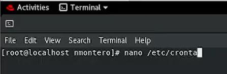
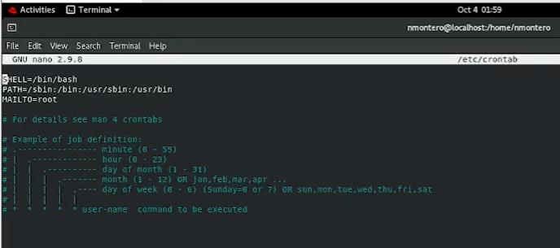
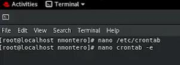
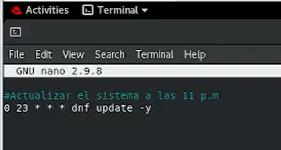
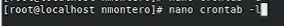
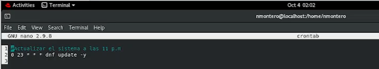
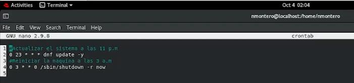
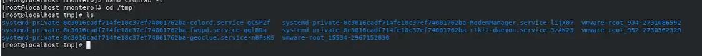
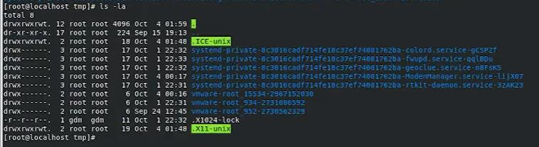
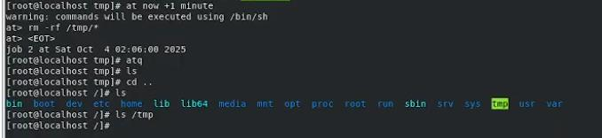

[← Volver al laboratorio](../README.md)

# 09 · Administración de tareas con cron y at


Programación de tareas automáticas en RHEL con dos mecanismos complementarios: **`cron`**, para tareas recurrentes (a nivel de sistema y a nivel de usuario), y **`at`**, para tareas que se ejecutan una única vez en un momento futuro.

> [!NOTE]
> Al igual que las prácticas de instalación de RHEL y configuración de red, esta no tuvo un How-To escrito por separado: se documentó únicamente con capturas de la terminal, tomadas como evidencia del procedimiento.

## Objetivo

Programar una tarea recurrente a nivel de sistema, una a nivel de usuario, y una tarea de ejecución única, usando `crontab` y `at` respectivamente.

## Entorno

| Elemento | Valor |
|---|---|
| Distribución | RHEL (Red Hat Enterprise Linux) |
| Mecanismos usados | `/etc/crontab` (sistema), `crontab -e` (usuario), `at` (tarea única) |

## Índice

- [Parte A: El crontab del sistema (/etc/crontab)](#parte-a-el-crontab-del-sistema-etccrontab)
- [Parte B: El crontab del usuario](#parte-b-el-crontab-del-usuario)
- [Parte C: Tareas de ejecución única con at](#parte-c-tareas-de-ejecución-única-con-at)
- [Sintaxis de cron](#sintaxis-de-cron)
- [Referencia de comandos](#referencia-de-comandos)
- [Solución de problemas frecuentes](#solución-de-problemas-frecuentes)

---

## Parte A: El crontab del sistema (/etc/crontab)

**1.** Abrimos el archivo de tareas programadas a nivel de sistema:

```bash
nano /etc/crontab
```




**2.** El archivo trae, por defecto, la configuración del intérprete (`SHELL`), la variable `PATH`, el destinatario de notificaciones (`MAILTO`) y un comentario de ejemplo con la sintaxis de los cinco campos de tiempo de `cron`.




---

## Parte B: El crontab del usuario

**1.** En vez de editar el archivo del sistema directamente, usamos `crontab -e`, que abre (y administra) el crontab del usuario actual:

```bash
crontab -e
```




> [!TIP]
> `/etc/crontab` y `crontab -e` gestionan tareas en dos niveles distintos. `/etc/crontab` requiere especificar el usuario que ejecuta cada tarea (una columna adicional) y aplica a todo el sistema; `crontab -e` administra únicamente las tareas del usuario que lo ejecuta, sin esa columna adicional, y es la forma recomendada para programar tareas que no requieren privilegios de todo el sistema.

**2.** Agregamos un comentario descriptivo y una tarea que actualiza el sistema todos los días a las 11:00 p.m.:

```cron
# actualizar el sistema a las 11 p.m.
0 23 * * * dnf update -y
```




**3.** Guardamos y salimos (`Ctrl + X` para salir de `nano`, confirmando guardar los cambios).

**4.** Para verificar las tareas programadas del usuario actual:

```bash
crontab -l
```




La salida confirma que la tarea quedó guardada correctamente.




**5.** Editamos nuevamente el crontab (`crontab -e`) y agregamos una segunda tarea: reiniciar el sistema todos los domingos a las 3:00 a.m.

```cron
# reiniciar el sistema a las 3 a.m.
0 3 * * 0 /sbin/shutdown -r now
```




---

## Parte C: Tareas de ejecución única con at

A diferencia de `cron` (tareas recurrentes), `at` programa una tarea que se ejecuta **una sola vez**, en un momento específico.

**1.** Antes de programar la tarea, revisamos el contenido de `/tmp`, el directorio que se va a limpiar:

```bash
cd /tmp
ls
```




```bash
ls -la
```




**2.** Programamos una tarea con `at`, para que se ejecute dentro de un minuto:

```bash
at now +1 minute
```

`at` muestra una advertencia indicando que los comandos se ejecutarán usando `/bin/sh`, y abre un modo interactivo (`at>`) donde se escribe el comando a ejecutar:

```text
at> rm -rf /tmp/*
at> <EOT>
```

`<EOT>` (*end of transmission*) se envía con `Ctrl + D`, y confirma el fin de la entrada. `at` responde con el número de trabajo programado y la fecha/hora exacta de ejecución.

> [!CAUTION]
> `rm -rf /tmp/*` elimina de forma **irreversible** todo el contenido de `/tmp`, sin pedir confirmación. En este laboratorio se usó como ejemplo sencillo de automatización de limpieza, pero cualquier tarea programada con `rm -rf` debe revisarse con mucho cuidado antes de confirmarla: un error en la ruta puede borrar datos que no se pretendía eliminar.

**3.** Consultamos la cola de tareas pendientes de `at`:

```bash
atq
```

**4.** Pasado el minuto programado, verificamos que la tarea se ejecutó revisando el contenido de `/tmp`:

```bash
ls
cd ..
ls
ls /tmp
```




El directorio `/tmp` queda vacío, confirmando que la tarea programada con `at` se ejecutó correctamente.

---

## Sintaxis de cron

```text
*  *  *  *  *  comando
│  │  │  │  │
│  │  │  │  └── día de la semana (0–6, domingo = 0)
│  │  │  └───── mes (1–12)
│  │  └──────── día del mes (1–31)
│  └─────────── hora (0–23)
└────────────── minuto (0–59)
```

Un asterisco (`*`) significa "cualquier valor". Por ejemplo, `0 23 * * *` se lee *"al minuto 0 de la hora 23, de cualquier día, de cualquier mes, de cualquier día de la semana"*: todos los días a las 11:00 p.m. De forma similar, `0 3 * * 0` es *"al minuto 0 de la hora 3, cualquier día del mes, cualquier mes, pero solo el día 0 de la semana (domingo)"*.

---

## Referencia de comandos

| Comando | Función |
|---|---|
| `nano /etc/crontab` | Edita el crontab del sistema (requiere especificar el usuario por tarea) |
| `crontab -e` | Edita el crontab del usuario actual |
| `crontab -l` | Lista las tareas programadas del usuario actual |
| `crontab -r` | Elimina todas las tareas programadas del usuario actual |
| `at <momento>` | Programa una tarea de ejecución única (p. ej. `at now +1 minute`, `at 23:00`) |
| `atq` | Lista las tareas pendientes programadas con `at` |
| `atrm <trabajo>` | Elimina una tarea pendiente de `at` por su número de trabajo |

---

## Solución de problemas frecuentes

| Problema | Causa probable | Solución |
|---|---|---|
| Una tarea de `/etc/crontab` no se ejecuta | Falta la columna del usuario que debe ejecutarla | A diferencia de `crontab -e`, `/etc/crontab` requiere una columna adicional con el usuario entre los campos de tiempo y el comando |
| `crontab -e` abre un crontab vacío inesperadamente | Se está editando el crontab de otro usuario, o de `root` sin pretenderlo | Verificar con `whoami` qué usuario está activo antes de editar |
| `at` no ejecuta la tarea programada | El servicio `atd` no está activo | Verificar con `systemctl status atd` y, de ser necesario, iniciarlo con `systemctl start atd` |
| Se programó una tarea con `at` por error | — | Listarla con `atq` y eliminarla con `atrm <número de trabajo>` antes de que se ejecute |

---

[← Volver al laboratorio](../README.md)
