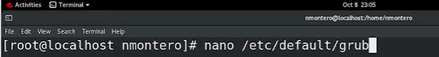
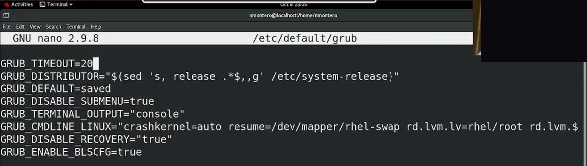
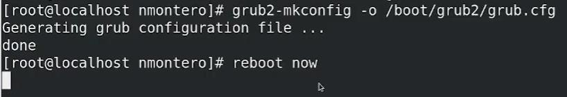
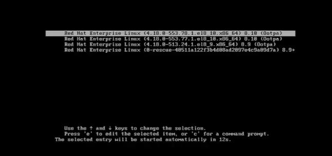
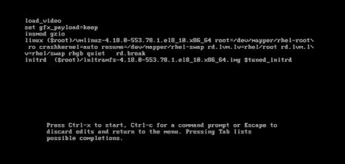
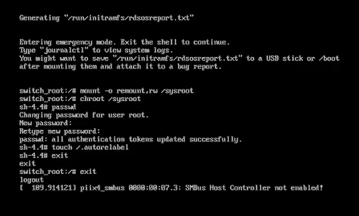

[← Volver al laboratorio](../README.md)

# 10 · Menú GRUB2 y recuperación de la contraseña de root


Personalización del menú de arranque **GRUB2** y recuperación de la contraseña de `root` mediante el modo de emergencia (`rd.break`), un procedimiento estándar de administración de sistemas para cuando se pierde el acceso a la cuenta de superusuario.


> [!IMPORTANT]
> Este procedimiento **requiere acceso físico o de consola** a la máquina (poder reiniciarla y editar el menú de arranque). No es un método de ataque remoto: es, precisamente, la razón por la que la seguridad física de los servidores importa tanto como la de red. Se documenta aquí como una habilidad legítima de administración: es el procedimiento oficial de Red Hat para recuperar el acceso a un sistema cuando se olvida la contraseña de `root`.

## Objetivo

Aumentar el tiempo de espera del menú de GRUB2 y usar el modo de emergencia del propio GRUB2 para restablecer la contraseña de `root` sin necesidad de conocer la anterior.

## Entorno

| Elemento | Valor |
|---|---|
| Distribución | RHEL (Red Hat Enterprise Linux) |
| Gestor de arranque | GRUB2 |
| Archivo de configuración | `/etc/default/grub` |

## Índice

- [Parte A: Personalizar el tiempo de espera de GRUB2](#parte-a-personalizar-el-tiempo-de-espera-de-grub2)
- [Parte B: Entrar al modo de emergencia con rd.break](#parte-b-entrar-al-modo-de-emergencia-con-rdbreak)
- [Parte C: Restablecer la contraseña de root](#parte-c-restablecer-la-contraseña-de-root)
- [Referencia de comandos](#referencia-de-comandos)
- [Solución de problemas frecuentes](#solución-de-problemas-frecuentes)

---

## Parte A: Personalizar el tiempo de espera de GRUB2

**1.** Editamos el archivo de configuración de GRUB2:

```bash
nano /etc/default/grub
```




**2.** Modificamos `GRUB_TIMEOUT` de `5` a `20`, para tener más tiempo al iniciar la máquina y poder interceptar el menú de arranque antes de que continúe automáticamente.

```text
GRUB_TIMEOUT=20
```




**3.** Guardamos los cambios y regeneramos el archivo de configuración real de GRUB2 a partir de este archivo de plantilla:

```bash
grub2-mkconfig -o /boot/grub2/grub.cfg
reboot now
```




> [!NOTE]
> `/etc/default/grub` es solo la plantilla de configuración; `grub2-mkconfig` es el comando que genera el archivo que GRUB2 realmente lee al arrancar (`/boot/grub2/grub.cfg`). Editar el primero sin regenerar el segundo no tiene ningún efecto.

---

## Parte B: Entrar al modo de emergencia con rd.break

**1.** Al reiniciar, con el tiempo de espera ya ampliado, aparece el menú de GRUB2 con las distintas entradas de kernel disponibles (incluida una entrada de rescate).




**2.** Nos situamos sobre la entrada que queremos arrancar y presionamos la tecla **`e`** para editarla.

**3.** Dentro del editor, nos ubicamos en la línea que comienza con `linux` y presionamos `Ctrl + E` para ir al final de esa línea. Ahí agregamos el parámetro:

```text
rd.break
```




`rd.break` interrumpe el proceso de arranque justo después de montar el sistema de archivos inicial (*initramfs*), pero antes de montar el sistema de archivos raíz definitivo, dejando el sistema en un modo de emergencia con acceso de `root` sin pedir contraseña.

**4.** Presionamos **`Ctrl + X`** para arrancar con ese parámetro agregado.

> [!TIP]
> El pie de esta pantalla resume los atajos disponibles: `Ctrl + X` para iniciar, `Ctrl + C` para abrir una línea de comandos de GRUB2, o `Escape` para descartar los cambios y volver al menú.

---

## Parte C: Restablecer la contraseña de root

**1.** El sistema arranca en modo de emergencia (*switch_root*), con el sistema de archivos raíz montado como **solo lectura**.

**2.** Lo remontamos con permisos de escritura y entramos a él con `chroot`:

```bash
mount -o remount,rw /sysroot
chroot /sysroot
```

**3.** Ya dentro, cambiamos la contraseña de `root` con el comando habitual:

```bash
passwd
```

**4.** Para que SELinux no bloquee el acceso tras el cambio (ya que `passwd` modifica `/etc/shadow` fuera del proceso normal de arranque, sin las etiquetas de seguridad correctas), creamos un archivo que fuerza a reetiquetar todo el sistema de archivos en el siguiente arranque:

```bash
touch /.autorelabel
```

**5.** Salimos del entorno `chroot` y, después, del modo de emergencia, para continuar con el arranque normal:

```bash
exit
exit
```




> [!IMPORTANT]
> El paso `touch /.autorelabel` es crítico en RHEL con SELinux habilitado (el valor por defecto). Sin él, el reetiquetado de seguridad de `/etc/shadow` queda desactualizado y el sistema puede **rechazar** el inicio de sesión con la contraseña recién creada, aunque sea correcta. El reinicio que sigue a este paso tarda más de lo normal, porque SELinux reetiqueta todo el sistema de archivos antes de completar el arranque.

---

## Referencia de comandos

| Comando | Función |
|---|---|
| `nano /etc/default/grub` | Edita la plantilla de configuración de GRUB2 |
| `grub2-mkconfig -o /boot/grub2/grub.cfg` | Regenera el archivo de configuración real de GRUB2 a partir de la plantilla |
| `e` (en el menú de GRUB2) | Edita la entrada de arranque seleccionada |
| `rd.break` | Parámetro de arranque que detiene el proceso antes de montar el sistema de archivos raíz, en modo de emergencia |
| `Ctrl + X` (en el editor de GRUB2) | Arranca con los parámetros editados |
| `mount -o remount,rw /sysroot` | Remonta el sistema de archivos raíz con permisos de escritura |
| `chroot /sysroot` | Cambia la raíz efectiva del sistema al sistema de archivos montado, para operar como si ya hubiera arrancado |
| `passwd` | Cambia la contraseña del usuario actual (`root`, dentro del `chroot`) |
| `touch /.autorelabel` | Marca el sistema para que SELinux reetiquete todos los archivos en el siguiente arranque |

---

## Solución de problemas frecuentes

| Problema | Causa probable | Solución |
|---|---|---|
| El menú de GRUB2 pasa demasiado rápido para interceptarlo | `GRUB_TIMEOUT` es muy bajo (o 0) | Aumentar el valor en `/etc/default/grub` y regenerar la configuración con `grub2-mkconfig` |
| Los cambios de `/etc/default/grub` no aparecen al arrancar | No se regeneró `/boot/grub2/grub.cfg` | Ejecutar `grub2-mkconfig -o /boot/grub2/grub.cfg` después de cada cambio |
| El sistema no permite iniciar sesión tras cambiar la contraseña | Falta el reetiquetado de SELinux | Verificar que se haya ejecutado `touch /.autorelabel` antes de salir del modo de emergencia, y reiniciar de nuevo |
| El arranque tarda mucho más de lo normal tras el cambio | SELinux está reetiquetando todo el sistema de archivos | Es esperado tras `/.autorelabel`; solo ocurre una vez, hay que dejarlo completar |
| `mount -o remount,rw /sysroot` indica error | El sistema de archivos raíz no se llama `/sysroot` en este punto del arranque | Verificar con `lsblk` o `cat /proc/mounts` el punto de montaje real antes de remontarlo |

---

[← Volver al laboratorio](../README.md)
