[← Volver al laboratorio](../README.md)

# 07 · Servidor de impresión CUPS compartido con Windows


Instalación de **CUPS** (*Common UNIX Printing System*) en RHEL, endurecimiento de su acceso administrativo por IP, creación de una impresora PDF virtual compartida en la red, y conexión a esa impresora desde un equipo Windows.


## Objetivo

Levantar un servidor de impresión en RHEL, restringir su panel de administración a la red local, publicar una impresora compartida, y verificar que un cliente Windows pueda agregarla e imprimir en ella.

## Entorno

| Elemento | Valor |
|---|---|
| Distribución | RHEL (Red Hat Enterprise Linux) |
| Servicio | CUPS (`cups`, `cups-pdf`) |
| Puerto | 631/tcp |
| IP del servidor | `192.168.0.16` |
| Impresora publicada | `Neury` (impresora PDF virtual) |
| Cliente | Windows |

## Índice

- [Parte A: Instalar CUPS](#parte-a-instalar-cups)
- [Parte B: Abrir el puerto en el firewall](#parte-b-abrir-el-puerto-en-el-firewall)
- [Parte C: Restringir el acceso por IP en cupsd.conf](#parte-c-restringir-el-acceso-por-ip-en-cupsdconf)
- [Parte D: Habilitar la administración remota](#parte-d-habilitar-la-administración-remota)
- [Parte E: Entrar a la interfaz web de CUPS](#parte-e-entrar-a-la-interfaz-web-de-cups)
- [Parte F: Crear la impresora compartida](#parte-f-crear-la-impresora-compartida)
- [Parte G: Conectar la impresora desde Windows](#parte-g-conectar-la-impresora-desde-windows)
- [Referencia de comandos](#referencia-de-comandos)
- [Demostración en video](#demostración-en-video)
- [Solución de problemas frecuentes](#solución-de-problemas-frecuentes)

---

## Parte A: Instalar CUPS

**1.** Instalamos CUPS y el controlador de impresora PDF virtual:

```bash
dnf install cups
dnf install cups-pdf
```

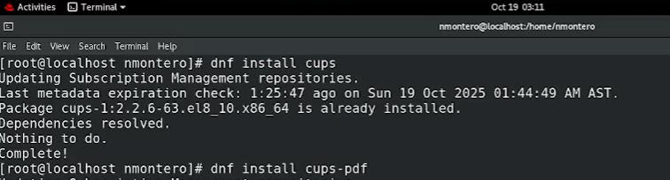


---

## Parte B: Abrir el puerto en el firewall

**1.** CUPS utiliza el puerto **631** (tanto para su protocolo de impresión como para su interfaz web de administración). Lo abrimos de forma permanente y recargamos el firewall:

```bash
firewall-cmd --permanent --add-port=631/tcp
firewall-cmd --reload
```

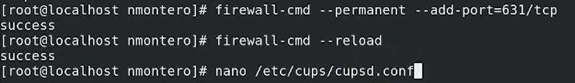


---

## Parte C: Restringir el acceso por IP en cupsd.conf

**1.** Editamos el archivo de configuración del demonio de CUPS:

```bash
nano /etc/cups/cupsd.conf
```

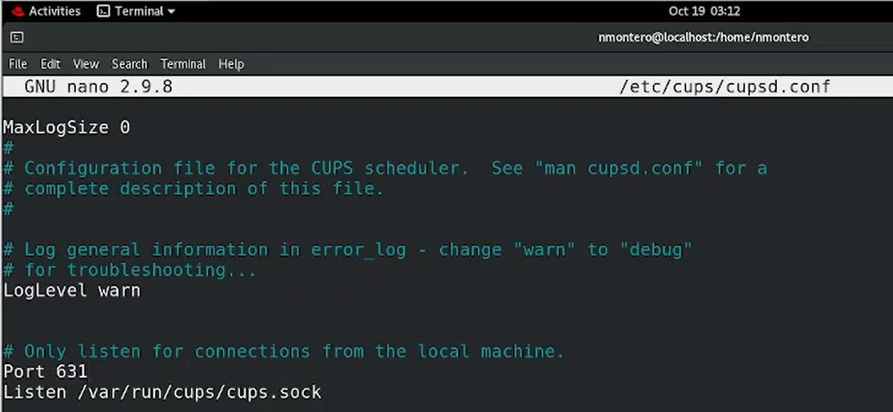


**2.** Restringimos el acceso general al servidor, permitiéndolo solo desde una IP específica de la red local:

```apache
# Restrict access to the server...
<Location />
  Order allow,deny
  Allow from 192.168.0.9
</Location>
```

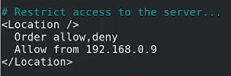


**3.** Hacemos lo mismo con las páginas de administración:

```apache
# Restrict access to the admin pages...
<Location /admin>
  Order allow,deny
  Allow from 192.168.0.9
</Location>
```

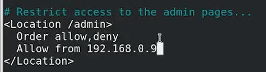


**4.** Y con los archivos de registro (log), agregando además la exigencia de autenticación para un usuario del sistema:

```apache
# Restrict access to log files...
<Location /admin/log>
  AuthType Default
  Require user @SYSTEM
  Order allow,deny
  Allow from 192.168.0.9
</Location>
```

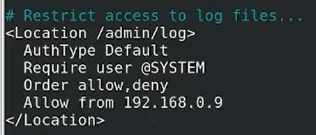


**5.** Por último, con los archivos de configuración:

```apache
# Restrict access to configuration files...
<Location /admin/conf>
  AuthType Default
  Require user @SYSTEM
  Order allow,deny
  Allow from 192.168.0.9
</Location>
```

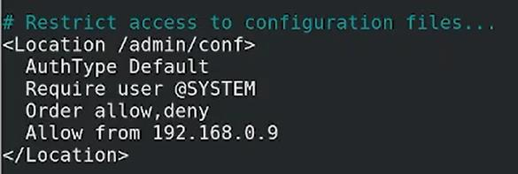


> [!NOTE]
> Cada bloque `<Location>` protege una sección distinta de CUPS. Separar las reglas por sección (servidor completo, panel de administración, registros y archivos de configuración) permite, por ejemplo, exigir autenticación adicional (`Require user @SYSTEM`) solo donde realmente hace falta, sin afectar el acceso normal a la cola de impresión.

---

## Parte D: Habilitar la administración remota

**1.** Con `cupsctl` habilitamos la administración remota, el acceso desde cualquier origen permitido por las reglas anteriores, y que las impresoras se compartan en la red. Luego iniciamos, habilitamos y reiniciamos el servicio:

```bash
cupsctl --remote-admin --remote-any --share-printers
systemctl start cups
systemctl enable cups
systemctl restart cups
```

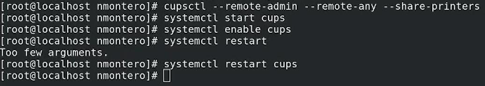


> [!TIP]
> En la captura, `systemctl restart` (sin especificar el servicio) devuelve `Too few arguments`, ya que a `systemctl` le falta indicar **qué** servicio reiniciar. El comando correcto, `systemctl restart cups`, sí se ejecuta sin problema.

---

## Parte E: Entrar a la interfaz web de CUPS

**1.** Desde el navegador, accedemos a `https://192.168.0.16:631` y se muestra la página de inicio de CUPS, con enlaces para usuarios, administradores y desarrolladores.

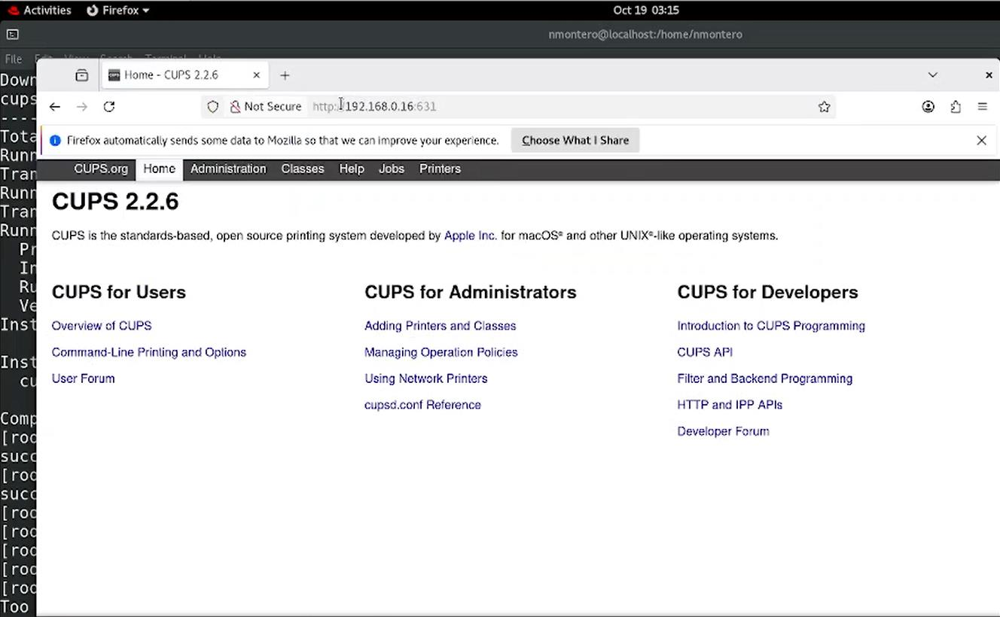


La interfaz tiene varias pestañas: Home, Administration, Classes, Help, Jobs y Printers.

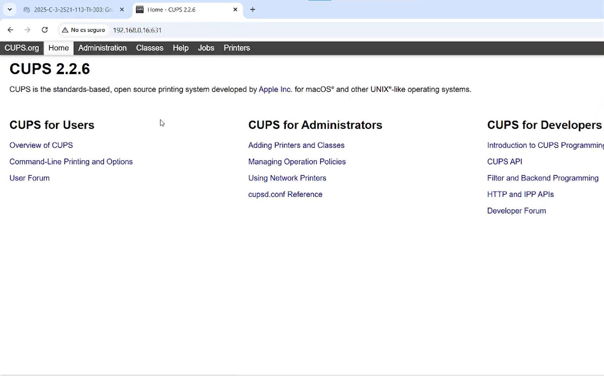


**2.** En la pestaña **Administration** se encuentran las opciones de gestión de impresoras, clases, trabajos y las suscripciones RSS del servidor.

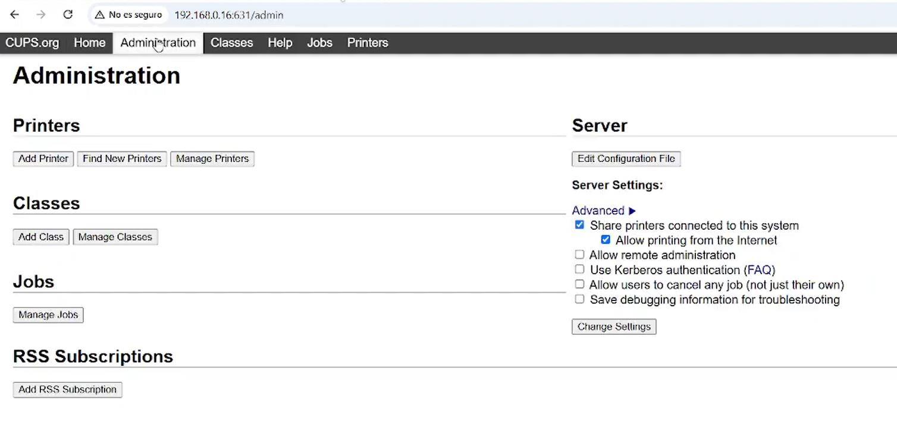


**3.** Como CUPS usa un certificado autofirmado, el navegador muestra una advertencia de conexión no privada. Se acepta el riesgo para continuar (es esperado en un entorno de laboratorio; en producción se usaría un certificado válido).

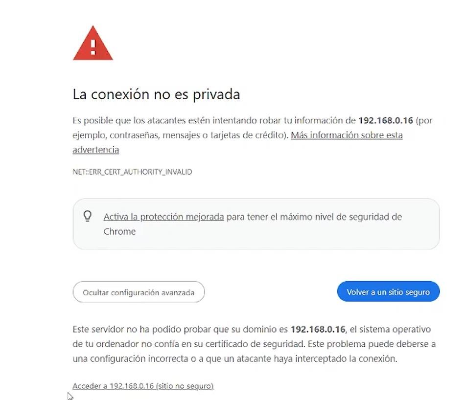


**4.** Para realizar cambios administrativos, CUPS solicita autenticarse con un usuario del sistema.

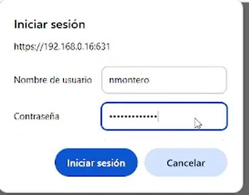


---

## Parte F: Crear la impresora compartida

**1.** Desde **Add Printer**, seleccionamos la impresora local disponible: **CUPS-PDF (Virtual PDF Printer)**.

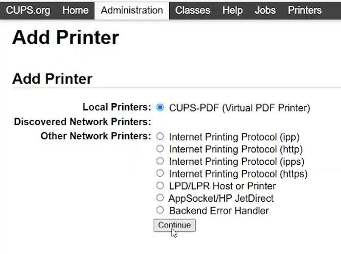


**2.** Le asignamos un nombre, descripción y ubicación, y confirmamos que se comparta en la red (**Share This Printer**).

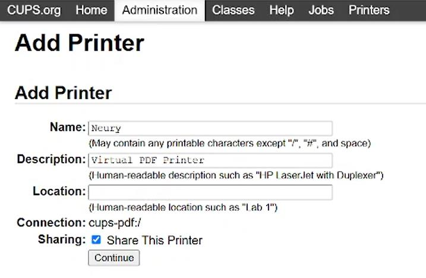


**3.** Seleccionamos el fabricante (**Make**) del controlador a utilizar.

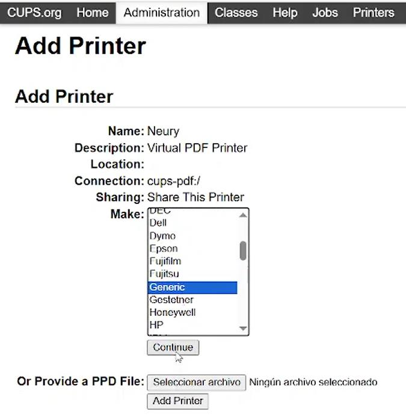


**4.** Y el modelo específico dentro de ese fabricante, que determina el controlador (*driver*) que CUPS usará para esta cola de impresión.

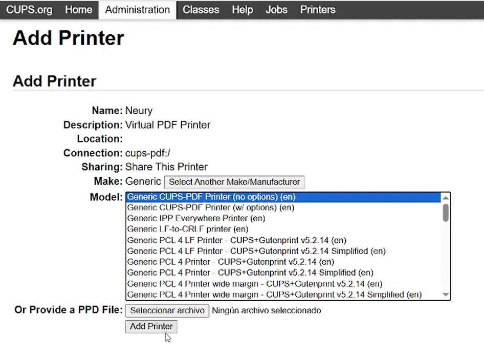


**5.** La impresora **Neury** queda publicada junto a la impresora **Cups-PDF** por defecto.

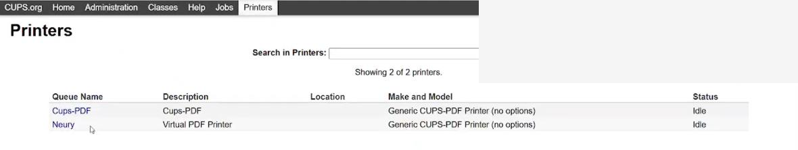


---

## Parte G: Conectar la impresora desde Windows

**1.** En Windows, vamos a **Configuración → Impresoras y escáneres** y elegimos **Agregar una impresora**.

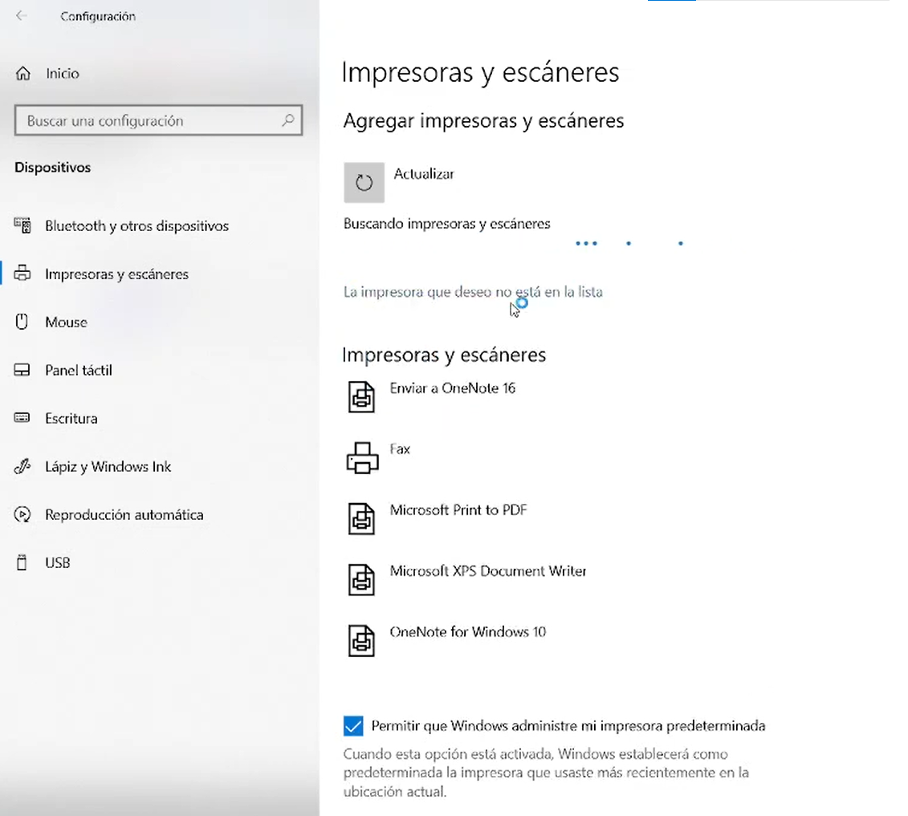


**2.** Entre las opciones de búsqueda, seleccionamos **Seleccionar una impresora compartida por nombre** e indicamos la URL de la impresora publicada en CUPS:

```text
http://192.168.0.16:631/printers/Neury
```

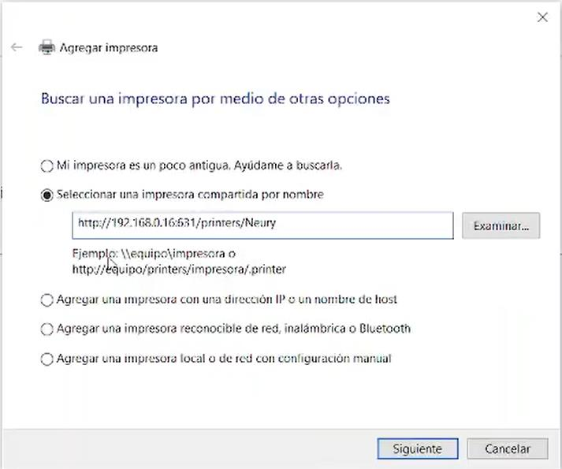


**3.** Windows se conecta a la impresora compartida.

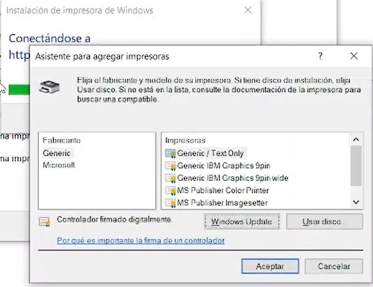


**4.** Se confirma que la impresora se agregó correctamente, usando el controlador genérico **Generic / Text Only**.

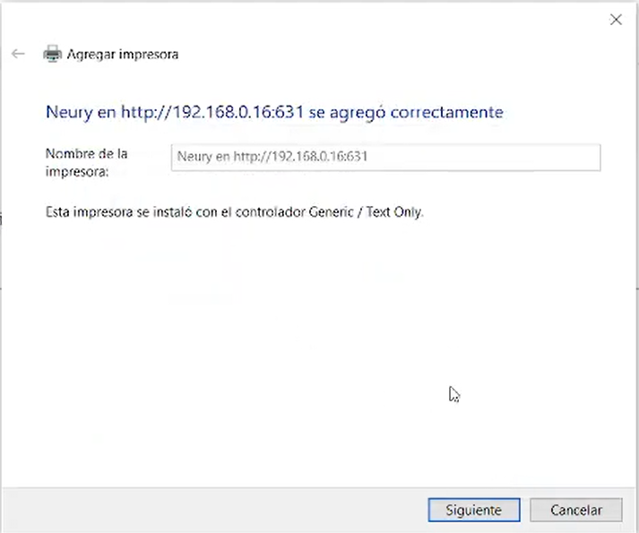


**5.** Windows instala el controlador correspondiente y muestra el nombre final de la impresora instalada.

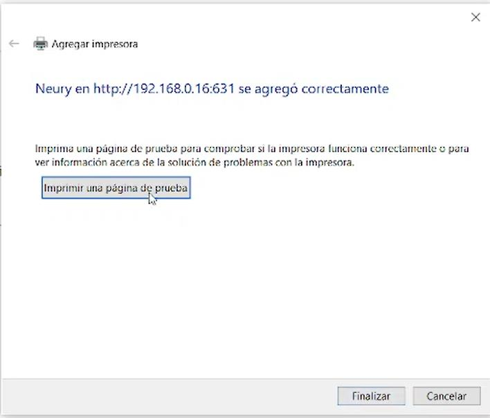


**6.** Como verificación final, se envía una página de prueba de impresión, que aparece en la cola de la impresora **Neury**.

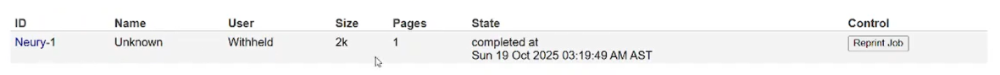


---

## Referencia de comandos

| Comando / archivo | Función |
|---|---|
| `dnf install cups cups-pdf` | Instala CUPS y el controlador de impresora PDF virtual |
| `firewall-cmd --permanent --add-port=631/tcp` | Abre el puerto de CUPS de forma permanente |
| `/etc/cups/cupsd.conf` | Configuración del demonio de CUPS: control de acceso por bloques `<Location>` |
| `cupsctl --remote-admin --remote-any --share-printers` | Habilita la administración remota y el uso compartido de impresoras |
| `systemctl start/enable/restart cups` | Inicia, habilita al arranque y reinicia el servicio de CUPS |
| `https://<servidor>:631` | Interfaz web de administración de CUPS |
| `http://<servidor>:631/printers/<nombre>` | URL de una impresora publicada, usada para conectarse desde un cliente |

---
## Demostración en video

Esta práctica cuenta con una demostración en video donde se muestra el proceso completo en el laboratorio. Las capturas del procedimiento se encuentran en la carpeta `images/`.

**Video de la práctica:** [Ver demostración en YouTube](https://youtu.be/lpj8E2lvS-8?si=ZTxSml33ERsddrgD)

---

## Solución de problemas frecuentes

| Problema | Causa probable | Solución |
|---|---|---|
| No se puede acceder a la interfaz web de CUPS | El puerto 631 no está abierto en el firewall | Verificar con `firewall-cmd --list-ports` y agregarlo si falta |
| El panel de administración rechaza el acceso desde otra IP | Las reglas `Allow from` en `cupsd.conf` no incluyen esa IP | Agregar la IP correspondiente a los bloques `<Location>` necesarios |
| `systemctl restart` devuelve `Too few arguments` | Falta especificar el nombre del servicio | Usar `systemctl restart cups`, indicando el servicio |
| Windows no encuentra la impresora compartida | La URL de conexión está mal escrita, o `--share-printers` no está habilitado | Verificar la URL (`http://<ip>:631/printers/<nombre>`) y el estado de `cupsctl` |
| El navegador bloquea la interfaz web de CUPS por el certificado | CUPS usa un certificado autofirmado | Aceptar el riesgo en un entorno de laboratorio, o instalar un certificado válido en producción |

---

[← Volver al laboratorio](../README.md)
